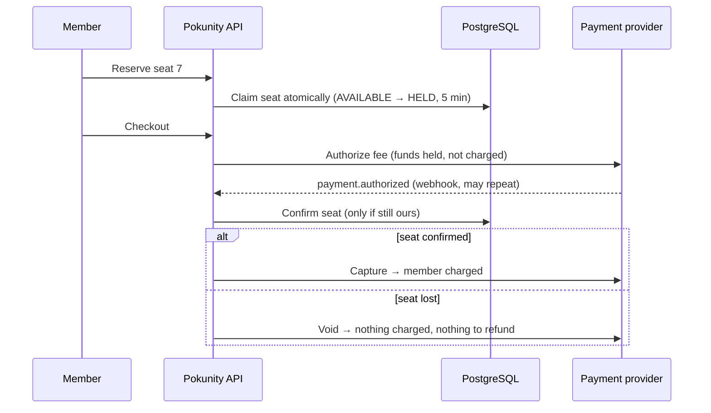

# Pokunity: Pocket Community

A marketplace for joining **Jameyas** (savings groups). Members browse 5,000+ groups, hold a seat for 5 minutes, and pay a joining fee. **They are charged only once the seat is confirmed**, so there is never a refund.

**Stack:** NestJS · PostgreSQL · Redis · Next.js · TanStack Query · Tailwind · Docker

## How to run

**Prerequisite:** Docker with Compose v2. Nothing else is needed on the host.

```bash
cp .env.example .env          # 1. create local config (git-ignored)
                              #    replace every "change-me" value with your own secret
docker compose up --build     # 2. build and start postgres, redis, backend, frontend
```

The first start takes a few minutes to build. The stack is ready when the backend reports `healthy`:

```bash
docker compose ps
```

| Open | URL |
|---|---|
| Web app | <http://localhost:3000> |
| API | <http://localhost:4000/api/v1> |
| Health | <http://localhost:4000/api/v1/health> |

To stop: `docker compose down`. Add `-v` to also delete the database.

## Seed data

**Seeding is automatic.** On every start the backend container runs migrations, then the seed, then the API. The seed is idempotent, so restarting never duplicates data. It takes about 1 s.

| What | Count | Notes |
|---|---|---|
| Demo users | 5 | Password `Pokunity123!` (see below) |
| Load-test users | 1,000 | `loadtest+N@pokunity.app`, used by the contention test |
| Jameyas | 5,000 | Random amounts, durations and fill levels, plus 2 fixed demo Jameyas |
| Featured campaign | 1 | `winter-savings-2026`, 15 Jameyas |

Common tasks:

```bash
# Re-run the seed by hand (safe at any time; fills in anything missing)
docker compose exec backend node dist/cli/seed.js

# Seed more Jameyas (adds the missing ones; never deletes)
docker compose exec -e SEED_JAMEYAS=10000 backend node dist/cli/seed.js

# Start from a clean database (migrations and seed run again on start)
docker compose down -v && docker compose up --build

# Start without seeding: set SKIP_SEED=true on the backend service in docker-compose.yml
```

### Demo users

| Email | Shows |
|---|---|
| `sara@pokunity.app` | Happy path: verified, low risk |
| `omar@pokunity.app` | KYC pending: can browse, cannot reserve |
| `lina@pokunity.app` | High risk: early seats are restricted |
| `khaled@pokunity.app` | Many expired holds: limited to 1 active hold |
| `noura@pokunity.app` | KYC service times out: cached status or "try again" |

At checkout, the payment token decides what the simulated provider does: `tok_success`, `tok_decline`, `tok_slow`, `tok_duplicate` or `tok_timeout` ([details](docs/api/README.md#payment-test-tokens)).

## Run the tests

```bash
# Backend: unit and integration tests (isolated test database)
docker compose -f docker-compose.yml -f backend/docker-compose.test.yml run --rm --build backend-test

# Frontend: unit and component tests
cd frontend && npm ci && npm test

# End to end through the running stack
cd frontend && npm run e2e

# 1,000 users booking the same Jameya (stack must be running)
docker compose exec backend npm run loadtest:contention
```

More commands: [backend](docs/backend/development.md) · [frontend](docs/frontend/development.md).

## How a booking works



## Documentation

| Topic | Read |
|---|---|
| **Task 1:** seat reservation | [Reservation design](docs/reservation/seat-reservation.md) · [edge cases](docs/reservation/edge-cases.md) |
| **Task 2:** marketplace | [Ranking](docs/marketplace/ranking-and-personalization.md) · [UX](docs/marketplace/ux-strategy.md) · [stale data](docs/marketplace/stale-data-and-optimistic-ui.md) · [A/B testing](docs/marketplace/ab-testing.md) |
| **Task 3:** 1,000 users at once | [High contention](docs/contention/high-contention.md) |
| Optional questions | [Idempotency, overbooking, recovery](docs/optional-questions.md) |
| API (every endpoint, with samples) | [API guide](docs/api/README.md) · [openapi.yaml](docs/api/openapi.yaml) |
| Architecture | [Overview](docs/architecture/overview.md) · [modules](docs/architecture/modules.md) · [database](docs/architecture/database.md) · [patterns](docs/architecture/design-patterns.md) · [decisions (ADRs)](docs/architecture/adr/README.md) |
| Frontend | [Architecture](docs/frontend/architecture.md) · [edge cases](docs/frontend/edge-cases.md) |
| Performance | [Backend](docs/performance/backend.md) · [frontend](docs/performance/frontend.md) · [caching](docs/performance/caching.md) |
| Operations | [Runbook](docs/operations/runbook.md) |

## Engineering rules

- No function, method or component is longer than **15 lines**, tests included. ESLint enforces this in both apps.
- Both apps are modular monoliths. Modules talk through public interfaces, and the frontend and backend talk only through the [API contract](docs/api/README.md).
- Database constraints, not just application code, guarantee no double booking and at most one capture per payment.
