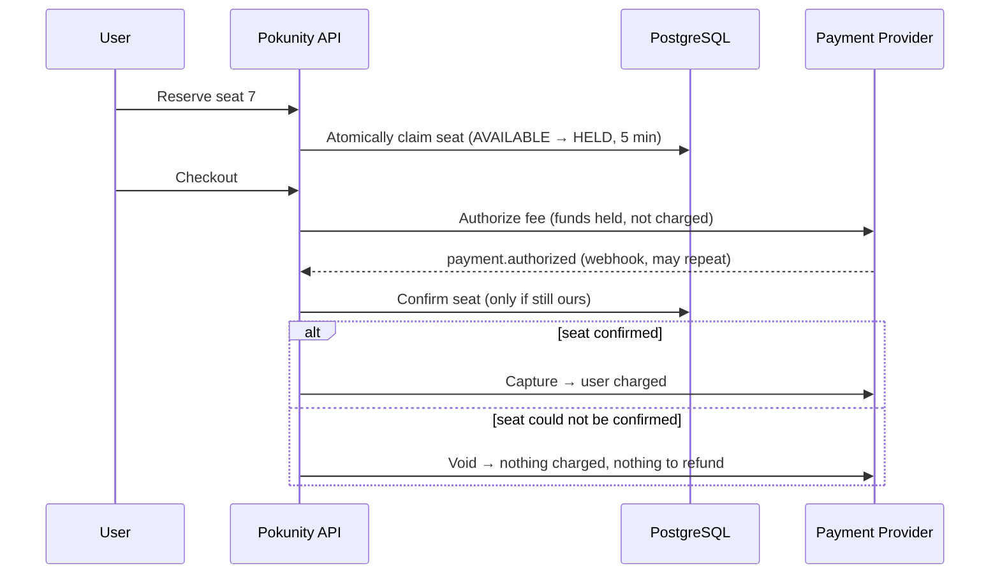

# Pokunity — Pocket Community

A marketplace for joining **Jameyas** (collaborative savings groups): browse 5,000+ groups, hold a seat, pay the joining fee, and get a guaranteed seat — **charged only when the seat is confirmed**.

## Run it

```bash
cp .env.example .env   # then set real secrets in .env (git-ignored)
docker compose up --build
```

| Service | URL |
|---|---|
| Web app | http://localhost:3000 |
| API | http://localhost:4000/api/v1 |
| Health | http://localhost:4000/api/v1/health |

Log in with any demo user (password `Pokunity123!`): `sara@`, `omar@`, `lina@`, `khaled@`, `noura@pokunity.app` — see [what each one demonstrates](docs/api/README.md#seeded-demo-users-password-for-all-pokunity123).

## Stack

NestJS · PostgreSQL · Redis · Next.js · TanStack Query · Tailwind · Docker — both apps are **modular monoliths**, talking only through the [API contract](docs/api/README.md).

## Documentation map

| I want to… | Read |
|---|---|
| Understand the API (every endpoint, with samples) | [docs/api/](docs/api/README.md) · [openapi.yaml](docs/api/openapi.yaml) |
| See the overall architecture | [docs/architecture/overview.md](docs/architecture/overview.md) |
| See backend modules & boundaries | [docs/architecture/modules.md](docs/architecture/modules.md) |
| See the database & its invariants | [docs/architecture/database.md](docs/architecture/database.md) |
| See design patterns used | [docs/architecture/design-patterns.md](docs/architecture/design-patterns.md) |
| Read architecture decisions (ADRs) | [docs/architecture/adr/](docs/architecture/adr/) |
| **Task 1** — Seat reservation mechanism | [docs/reservation/seat-reservation.md](docs/reservation/seat-reservation.md) |
| Edge cases & how they're solved (backend) | [docs/reservation/edge-cases.md](docs/reservation/edge-cases.md) |
| **Task 2** — Ranking & personalization | [docs/marketplace/ranking-and-personalization.md](docs/marketplace/ranking-and-personalization.md) |
| **Task 2** — UX & conversion strategy | [docs/marketplace/ux-strategy.md](docs/marketplace/ux-strategy.md) |
| **Task 2** — Stale data & optimistic UI | [docs/marketplace/stale-data-and-optimistic-ui.md](docs/marketplace/stale-data-and-optimistic-ui.md) |
| **Task 2** — A/B testing (optional) | [docs/marketplace/ab-testing.md](docs/marketplace/ab-testing.md) |
| **Task 3** — 1,000 users, same Jameya | [docs/contention/high-contention.md](docs/contention/high-contention.md) |
| Optional questions (idempotency, overbooking, recovery) | [docs/optional-questions.md](docs/optional-questions.md) |
| Frontend architecture | [docs/frontend/architecture.md](docs/frontend/architecture.md) |
| Frontend edge cases | [docs/frontend/edge-cases.md](docs/frontend/edge-cases.md) |
| Develop / test locally | [backend](docs/backend/development.md) · [frontend](docs/frontend/development.md) |
| Performance (benchmarks, caching, rate limits, circuit breakers) | [backend](docs/performance/backend.md) · [frontend](docs/performance/frontend.md) |
| Operate it / handle incidents | [docs/operations/runbook.md](docs/operations/runbook.md) |

## The core guarantee in one picture



## Engineering rules

- No function, method or component is longer than **15 lines** (enforced by ESLint in both apps).
- Modules communicate only through public interfaces; the frontend and backend only through [`docs/api`](docs/api/README.md).
- Database constraints, not just app code, protect the invariants (no double booking, one capture per payment).
