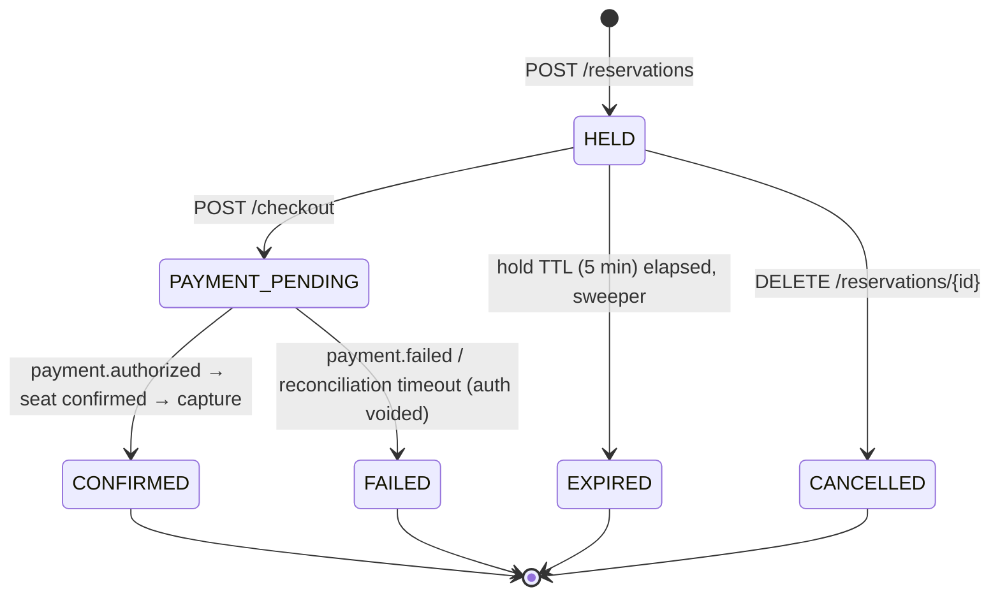

# Reservations

Hold a seat, pay, get confirmed. How it works inside: [seat reservation](../reservation/seat-reservation.md).

## Lifecycle



- **Money:** funds are only authorized (held) during `PAYMENT_PENDING`, and captured only after the seat is confirmed. If the seat can't be confirmed, the authorization is voided: no charge, no refund.
- **Expiry:** only `HELD` reservations expire. Once `PAYMENT_PENDING`, only the payment result (or reconciliation) can end it.

## Object: `Reservation`

```json
{
  "id": "c2d3e4f5-a6b7-4c8d-9e0f-1a2b3c4d5e6f",
  "jameyaId": "5f8a1c3e-2b4d-4e6f-8a9b-0c1d2e3f4a5b",
  "jameyaName": "Riyadh Savers 12M",
  "seatNumber": 11,
  "fee": 0,
  "monthlyAmount": 100000,
  "currency": "SAR",
  "status": "HELD",
  "expiresAt": "2026-11-21T10:05:00.000Z",
  "failureReason": null,
  "payment": null,
  "createdAt": "2026-11-21T10:00:00.000Z",
  "updatedAt": "2026-11-21T10:00:00.000Z"
}
```

| Field | Meaning |
|---|---|
| `fee` | Fixed when the hold is made |
| `expiresAt` | Countdown while `HELD` |
| `payment` | `{ id, status, amount, currency, resolveBy }` or `null` |
| `payment.resolveBy` | Latest time a pending payment will be settled (created + 10 min); `null` once final |
| `payment.status` on failure | Declined or never authorized → `FAILED`. Authorized too late and voided → `VOIDED`. Never charged either way |
| `failureReason` | `PAYMENT_DECLINED`, `PAYMENT_TIMEOUT`, `HOLD_EXPIRED`, `SEAT_CONFLICT` |

Zero-fee seats skip payment: checkout returns `200` with `status: "CONFIRMED"` and `payment: null`.

---

## POST `/api/v1/reservations`

Holds one seat for 5 minutes.

### Request

```http
POST /api/v1/reservations
Authorization: Bearer <jwt>
Idempotency-Key: 7e1d9c2a-4b3f-4e5a-8d6c-1f2e3a4b5c6d
Content-Type: application/json

{ "jameyaId": "5f8a1c3e-2b4d-4e6f-8a9b-0c1d2e3f4a5b", "seatNumber": 11 }
```

**201 Created** → `Reservation` with `status: "HELD"` (see object above).

**Checks, cheapest first:**

1. Rate limit: 5 requests / 10 s / user → `429 RATE_LIMITED`
2. Idempotency key ([rules](README.md#idempotency))
3. KYC → `403 KYC_REQUIRED` / `503 KYC_UNAVAILABLE`
4. Hold limits → `409 HOLD_LIMIT_REACHED`, `409 ACTIVE_RESERVATION_EXISTS`
5. Risk restriction on seat → `403 RISK_RESTRICTED`
6. Redis availability gate → `409 JAMEYA_FULL`
7. Atomic seat claim in PostgreSQL → `409 SEAT_UNAVAILABLE`

### 409 example

```json
{
  "error": {
    "code": "SEAT_UNAVAILABLE",
    "message": "Seat 11 is no longer available.",
    "details": { "seatNumber": 11 },
    "traceId": "8c1f6a0e-3a51-4c4e-9a43-2b1c9d1f7e10"
  }
}
```

---

## GET `/api/v1/reservations`

The viewer's reservations, newest first.

| Param | Type | Notes |
|---|---|---|
| `status` | `ReservationStatus` (optional, repeatable) | e.g. `?status=HELD&status=PAYMENT_PENDING` |
| `page` | int, default 1 | v1.1 |
| `pageSize` | int, default 20, max 50 | v1.1 |

### 200 OK

```json
{
  "data": [ { "...": "Reservation" } ],
  "meta": { "page": 1, "pageSize": 20, "total": 3 }
}
```

---

## GET `/api/v1/reservations/{id}`

Live status, never cached. Poll it during checkout: every ~1.5 s, slowing to 3 s after 15 s, until the status is final.

**200 OK** (after successful payment)

```json
{
  "id": "c2d3e4f5-a6b7-4c8d-9e0f-1a2b3c4d5e6f",
  "jameyaId": "5f8a1c3e-2b4d-4e6f-8a9b-0c1d2e3f4a5b",
  "jameyaName": "Riyadh Savers 12M",
  "seatNumber": 7,
  "fee": 12000,
  "monthlyAmount": 100000,
  "currency": "SAR",
  "status": "CONFIRMED",
  "expiresAt": "2026-11-21T10:05:00.000Z",
  "failureReason": null,
  "payment": { "id": "e1f2a3b4-c5d6-4e7f-8a9b-0c1d2e3f4a5b", "status": "CAPTURED", "amount": 12000, "currency": "SAR" },
  "createdAt": "2026-11-21T10:00:00.000Z",
  "updatedAt": "2026-11-21T10:01:12.000Z"
}
```

**403** `FORBIDDEN` · **404** `NOT_FOUND`

---

## POST `/api/v1/reservations/{id}/checkout`

Moves `HELD` to `PAYMENT_PENDING` and asks the provider to authorize the fee. The result arrives later by webhook; poll `GET /reservations/{id}`.

### Request

```http
POST /api/v1/reservations/c2d3e4f5-a6b7-4c8d-9e0f-1a2b3c4d5e6f/checkout
Authorization: Bearer <jwt>
Idempotency-Key: 3a4b5c6d-7e8f-4a9b-8c0d-1e2f3a4b5c6d
Content-Type: application/json

{ "paymentMethodToken": "tok_success" }
```

### 202 Accepted

```json
{
  "id": "c2d3e4f5-a6b7-4c8d-9e0f-1a2b3c4d5e6f",
  "status": "PAYMENT_PENDING",
  "seatNumber": 7,
  "fee": 12000,
  "currency": "SAR",
  "payment": { "id": "e1f2a3b4-c5d6-4e7f-8a9b-0c1d2e3f4a5b", "status": "AUTHORIZING", "amount": 12000, "currency": "SAR" },
  "...": "remaining Reservation fields"
}
```

**200 OK** – only for zero-fee seats: `Reservation` with `status: "CONFIRMED"`, `payment: null`.

### Errors

- `410 RESERVATION_EXPIRED`: the hold expired first.
- `409 INVALID_STATE`: not `HELD`. A retry with the same `Idempotency-Key` replays the original 202 instead.
- `403 FORBIDDEN`, `404 NOT_FOUND`, `400 VALIDATION_ERROR`.

---

## DELETE `/api/v1/reservations/{id}`

Releases your own `HELD` seat. Safe to repeat: an already `CANCELLED` reservation returns 200 again.

**200 OK** → `Reservation` with `status: "CANCELLED"`

**409** `INVALID_STATE` (e.g. `PAYMENT_PENDING` or `CONFIRMED` cannot be cancelled) · **403** · **404**
