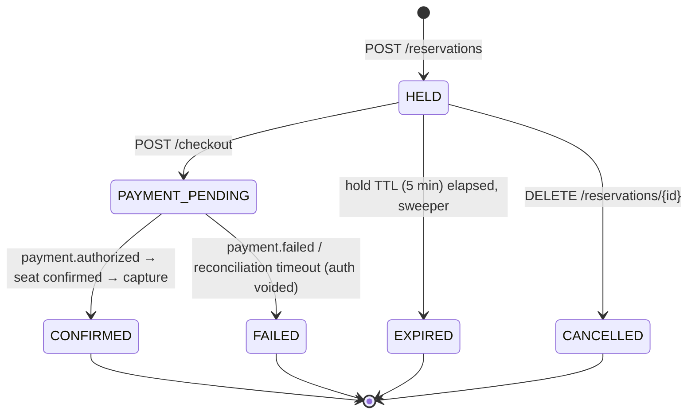

# Reservations (Seat Hold → Payment → Confirmation)

## Lifecycle



**Money guarantee:** the provider only **authorizes** (holds funds) during `PAYMENT_PENDING`.
Funds are **captured only after the seat is confirmed** in the same DB transaction that marks
it `CONFIRMED`. If confirmation is impossible the authorization is **voided** — no charge,
therefore no refund.

**Expiry guarantee:** the expiry sweeper only expires `HELD` reservations. Once a reservation is
`PAYMENT_PENDING` its seat cannot be released by the sweeper; only the payment outcome
(or reconciliation) can resolve it.

## Object: `Reservation`

```json
{
  "id": "c2d3e4f5-a6b7-4c8d-9e0f-1a2b3c4d5e6f",
  "jameyaId": "5f8a1c3e-2b4d-4e6f-8a9b-0c1d2e3f4a5b",
  "jameyaName": "Riyadh Savers 12M",
  "seatNumber": 11,
  "fee": 0,
  "monthlyAmount": 100000,
  "currency": "SAR",
  "status": "HELD",
  "expiresAt": "2026-11-21T10:05:00.000Z",
  "failureReason": null,
  "payment": null,
  "createdAt": "2026-11-21T10:00:00.000Z",
  "updatedAt": "2026-11-21T10:00:00.000Z"
}
```

- `fee` is **locked at hold time**; later price changes don't affect this reservation.
- `expiresAt` is meaningful only while `HELD` (UI shows a countdown).
- `payment` (when present): `{ "id": "uuid", "status": "PaymentStatus", "amount": int, "currency": "SAR" }`.
- `failureReason` (when `FAILED`/`EXPIRED`): `PAYMENT_DECLINED`, `PAYMENT_TIMEOUT`, `HOLD_EXPIRED`, `SEAT_CONFLICT`.
- Zero-fee seats still go through checkout, but no payment is created: checkout returns **200** with `status: "CONFIRMED"` and `payment: null`.

---

## POST `/api/v1/reservations`

Places a temporary hold (default **5 minutes**) on a specific seat.

**Request**
```http
POST /api/v1/reservations
Authorization: Bearer <jwt>
Idempotency-Key: 7e1d9c2a-4b3f-4e5a-8d6c-1f2e3a4b5c6d
Content-Type: application/json

{ "jameyaId": "5f8a1c3e-2b4d-4e6f-8a9b-0c1d2e3f4a5b", "seatNumber": 11 }
```

**201 Created** → `Reservation` with `status: "HELD"` (see object above).

**Checks, in order** (fail fast, cheapest first):
1. Rate limit: 5 requests / 10 s / user → `429 RATE_LIMITED`
2. Idempotency key handling (see [README](README.md#idempotency))
3. Eligibility: KYC (cached, circuit-breaker protected) → `403 KYC_REQUIRED` / `503 KYC_UNAVAILABLE`
4. Behavior limits → `409 HOLD_LIMIT_REACHED`, `409 ACTIVE_RESERVATION_EXISTS`
5. Risk restriction on seat → `403 RISK_RESTRICTED`
6. Fast-fail availability gate (Redis counter) → `409 JAMEYA_FULL`
7. Atomic seat claim in PostgreSQL (conditional update) → `409 SEAT_UNAVAILABLE`

**409 example**
```json
{
  "error": {
    "code": "SEAT_UNAVAILABLE",
    "message": "Seat 11 is no longer available.",
    "details": { "seatNumber": 11 },
    "traceId": "8c1f6a0e-3a51-4c4e-9a43-2b1c9d1f7e10"
  }
}
```

---

## GET `/api/v1/reservations`

Lists the viewer's reservations, newest first.

| Param | Type | Notes |
|---|---|---|
| `status` | `ReservationStatus` (optional, repeatable) | e.g. `?status=HELD&status=PAYMENT_PENDING` |

**200 OK**
```json
{ "data": [ { "...": "Reservation" } ] }
```

---

## GET `/api/v1/reservations/{id}`

Authoritative status (never cached). **Polling target** during checkout: poll every ~1.5 s
until status is terminal; back off to 3 s after 15 s.

**200 OK** (after successful payment)
```json
{
  "id": "c2d3e4f5-a6b7-4c8d-9e0f-1a2b3c4d5e6f",
  "jameyaId": "5f8a1c3e-2b4d-4e6f-8a9b-0c1d2e3f4a5b",
  "jameyaName": "Riyadh Savers 12M",
  "seatNumber": 7,
  "fee": 12000,
  "monthlyAmount": 100000,
  "currency": "SAR",
  "status": "CONFIRMED",
  "expiresAt": "2026-11-21T10:05:00.000Z",
  "failureReason": null,
  "payment": { "id": "e1f2a3b4-c5d6-4e7f-8a9b-0c1d2e3f4a5b", "status": "CAPTURED", "amount": 12000, "currency": "SAR" },
  "createdAt": "2026-11-21T10:00:00.000Z",
  "updatedAt": "2026-11-21T10:01:12.000Z"
}
```

**403** `FORBIDDEN` · **404** `NOT_FOUND`

---

## POST `/api/v1/reservations/{id}/checkout`

Moves a `HELD` reservation to `PAYMENT_PENDING` and asks the provider to **authorize** the fee.
Result arrives asynchronously via the provider webhook; client polls `GET /reservations/{id}`.

**Request**
```http
POST /api/v1/reservations/c2d3e4f5-a6b7-4c8d-9e0f-1a2b3c4d5e6f/checkout
Authorization: Bearer <jwt>
Idempotency-Key: 3a4b5c6d-7e8f-4a9b-8c0d-1e2f3a4b5c6d
Content-Type: application/json

{ "paymentMethodToken": "tok_success" }
```

**202 Accepted**
```json
{
  "id": "c2d3e4f5-a6b7-4c8d-9e0f-1a2b3c4d5e6f",
  "status": "PAYMENT_PENDING",
  "seatNumber": 7,
  "fee": 12000,
  "currency": "SAR",
  "payment": { "id": "e1f2a3b4-c5d6-4e7f-8a9b-0c1d2e3f4a5b", "status": "AUTHORIZING", "amount": 12000, "currency": "SAR" },
  "...": "remaining Reservation fields"
}
```

**200 OK** – only for zero-fee seats: `Reservation` with `status: "CONFIRMED"`, `payment: null`.

**Errors**
- `410 RESERVATION_EXPIRED` – hold expired before checkout (checked atomically).
- `409 INVALID_STATE` – not `HELD` (e.g. already `PAYMENT_PENDING`). `details.status` = current status.
  A retried checkout with the **same** Idempotency-Key replays the original 202 instead.
- `403 FORBIDDEN`, `404 NOT_FOUND`, `400 VALIDATION_ERROR`.

---

## DELETE `/api/v1/reservations/{id}`

Releases the viewer's own `HELD` reservation (seat becomes `AVAILABLE`). Idempotent:
deleting an already `CANCELLED` reservation returns 200 with the same body.

**200 OK** → `Reservation` with `status: "CANCELLED"`

**409** `INVALID_STATE` (e.g. `PAYMENT_PENDING` or `CONFIRMED` cannot be cancelled) · **403** · **404**
