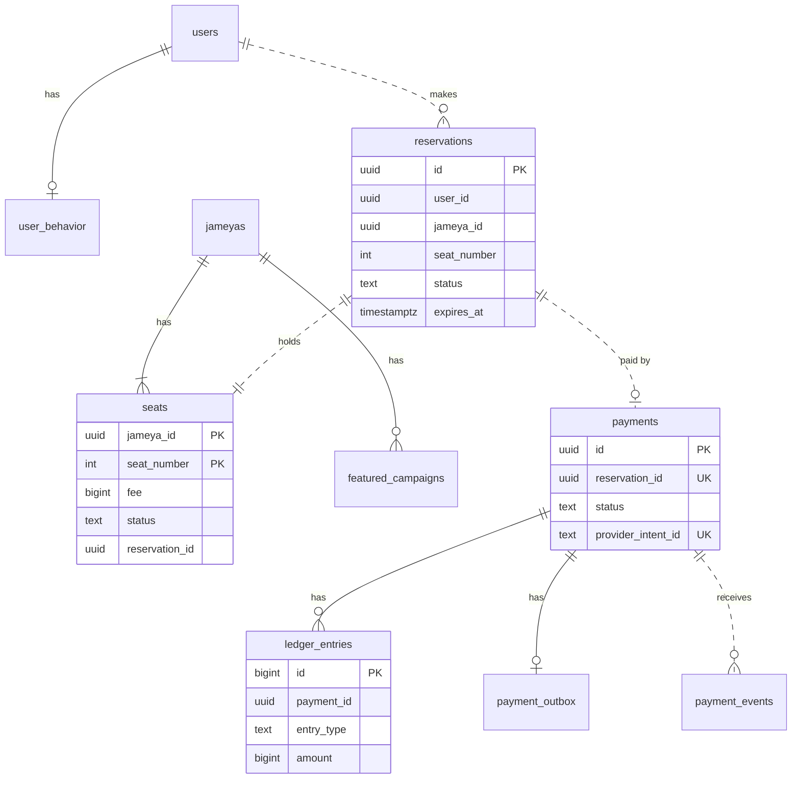

# Database

PostgreSQL 16 is the source of truth. The schema is in [`backend/migrations/`](../../backend/migrations/). Migrations are forward-only and run automatically when the backend starts; the seed runs next ([seeding](../../README.md#seed-data)).

| Migration | Adds |
|---|---|
| `0001_initial_schema.sql` | Tables, constraints, partial unique indexes, status-guard triggers |
| `0002_performance.sql` | Denormalised seat totals and fee range on `jameyas`; hot-path indexes |
| `0003_token_version.sql` | `users.token_version` for "log out everywhere" |
| `0004_seat_holder_index.sql` | Fast count of a viewer's active holds |

## Tables

Solid lines are foreign keys inside a module. Dotted lines are references across modules, by UUID only ([why](modules.md#boundary-rules)).

Other tables: `idempotency_keys`, `analytics_events`, `audit_log` (append-only). Money is always `bigint` halalas, and the currency is always `SAR`.

## Invariants and what enforces them

| Invariant | Enforced by |
|---|---|
| One winner per seat | `UPDATE seats ... WHERE status='AVAILABLE'` in the reservation transaction |
| One live reservation per seat | Partial unique index on `(jameya_id, seat_number)` for live statuses |
| One active hold per member per Jameya | Partial unique index on `(user_id, jameya_id)` → `409 ACTIVE_RESERVATION_EXISTS` |
| Only legal status changes | Triggers on `reservations`, `payments`, `seats` |
| One payment per reservation | `payments.reservation_id UNIQUE` |
| Each webhook processed once | `payment_events.event_id` primary key |
| Captured or voided, once | One outbox row per payment |
| Ledger can't double count | `UNIQUE (payment_id, entry_type)`, append-only |
| Audit can't be edited | Append-only triggers |

## Hot-path indexes

| Index | Serves |
|---|---|
| `reservations (expires_at) WHERE status='HELD'` | Hold sweeper |
| `reservations (user_id, created_at DESC)` | My reservations |
| `seats (jameya_id) WHERE status='AVAILABLE'` | Availability counts |
| `seats (holder_user_id) WHERE status='HELD'` | Viewer's hold count |
| `payments (created_at) WHERE status='AUTHORIZING'` | Reconciliation |
| `payment_outbox (next_attempt_at) WHERE status='PENDING'` | Outbox relay |
| `analytics_events (experiment_key, variant, type)` | Experiment reports |

## Concurrency

- READ COMMITTED isolation. Correctness comes from **conditional writes**, not read-then-write.
- The per-member hold limit is checked under `pg_advisory_xact_lock` for that member.
- The sweeper uses `FOR UPDATE SKIP LOCKED`, so it never blocks a checkout on the same row.
- Webhooks lock the payment row, so events for one payment apply one at a time.
