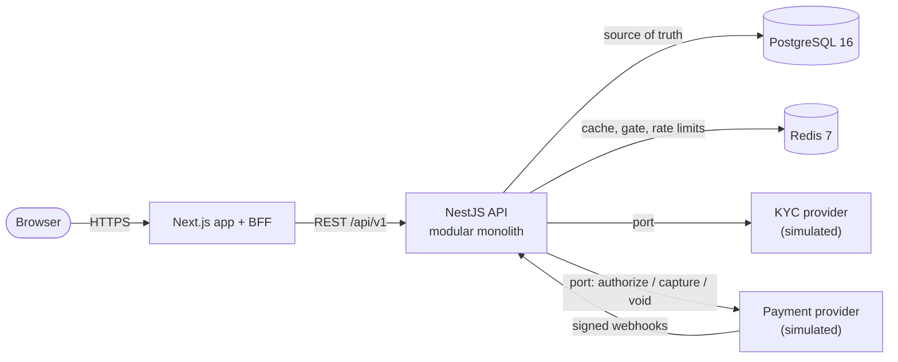
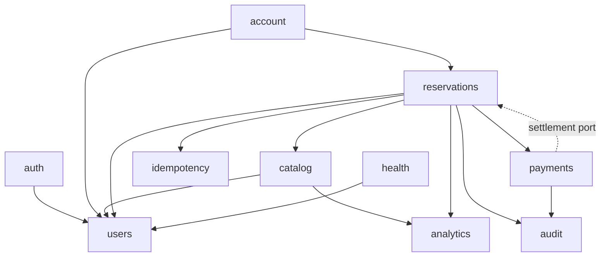
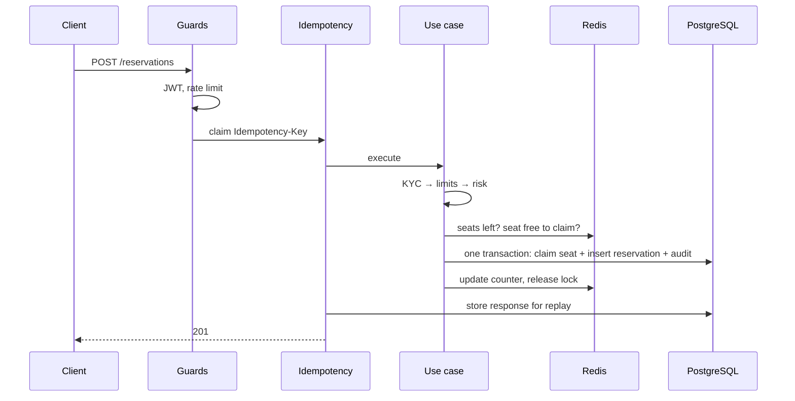

# Architecture Overview

**Two guarantees drive the design:** no member is charged without a seat, and no seat is sold twice.

Related: [modules](modules.md) · [database](database.md) · [patterns](design-patterns.md) · [decisions](adr/README.md)

## System

The KYC and payment providers are simulated inside the backend, so `docker compose up` runs everything, including slow, declined, duplicate and lost payments.

## Principles

| Principle | In practice |
|---|---|
| PostgreSQL is the only source of truth | Redis can vanish without breaking correctness ([ADR-0003](adr/0003-postgres-source-of-truth-redis-as-gate.md)) |
| Never charge, then refund | Authorize → confirm seat → capture, otherwise void ([ADR-0002](adr/0002-authorize-capture-not-refund.md)) |
| No provider calls inside transactions | Capture and void go through an outbox ([ADR-0004](adr/0004-transactional-outbox.md)) |
| Fail closed on compliance | KYC unknown → booking refused; browsing still works |
| The database guards itself | Unique indexes, checks and triggers back up the code |
| Small units | Module facades; functions ≤ 15 lines |

## Modules

No cycles. Payments must update reservations when a webhook arrives, so it declares a port that reservations implements. Details: [modules](modules.md).

## Booking request

Every request has an `X-Request-Id`. It appears in every log line and as `error.traceId`.

## Background jobs

They run in the same process. A PostgreSQL advisory lock makes sure only one instance runs each job.

| Job | Every | Does |
|---|---|---|
| Hold sweeper | 5 s | Expires overdue `HELD` reservations and frees their seats |
| Outbox relay | 1 s | Sends capture and void to the provider, with retries |
| Reconciliation | 10 s | Settles payments stuck for more than 2 min; times out at 10 min |
| Gate rebuild | 10 s | Recomputes Redis seat counters from PostgreSQL |
| Idempotency cleanup | 10 min | Deletes keys older than 24 h |

To run jobs separately later, deploy the same image twice: API replicas with `JOBS_ENABLED=false` and one worker with `JOBS_ENABLED=true`.

## Technology

| Concern | Choice | Why |
|---|---|---|
| Framework | NestJS 11, TypeScript strict | Modules and dependency injection suit a modular monolith |
| Data access | `pg` with hand-written SQL | Locking statements must be explicit and reviewable ([ADR-0007](adr/0007-raw-sql-over-orm.md)) |
| Database | PostgreSQL 16 | Row locks, partial unique indexes, triggers, `SKIP LOCKED` |
| Cache | Redis 7 | Fast counters, locks and rate limits; disposable |
| Jobs | `@nestjs/schedule` + advisory locks | No extra infrastructure |
| Validation | `class-validator`, `zod` for config | Won't start with bad config |
| Auth | JWT (1 h), bcrypt | Revocable via logout ([ADR-0012](adr/0012-token-revocation.md)) |
| Tests | Jest on real PostgreSQL and Redis | Concurrency can only be proven on the real database |

**In production:** the same images on ECS or Kubernetes, managed PostgreSQL (Multi-AZ) and Redis, autoscaled API replicas, one worker for jobs, and PgBouncer once connection counts grow.
