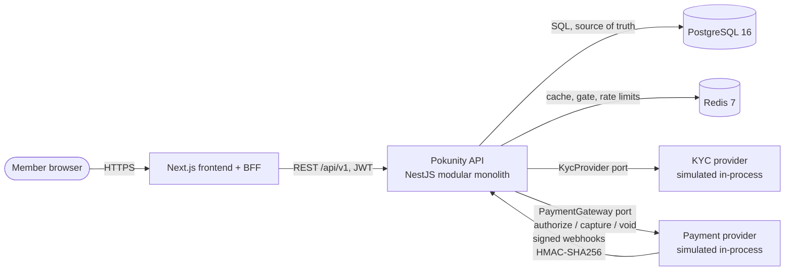
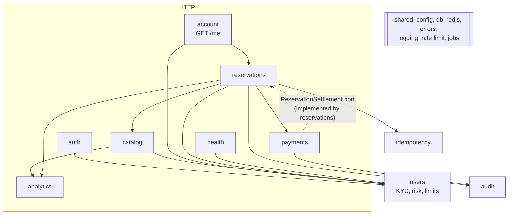

# Backend Architecture Overview

> Scope: the Pokunity API (`backend/`). The contract it implements is frozen in [`docs/api`](../api/README.md).
> Related: [modules](modules.md) · [database](database.md) · [design patterns](design-patterns.md) · [ADRs](adr/)

## 1. System context

Pokunity is a regulated marketplace for Jameyas (rotating savings groups). A member browses
open Jameyas, holds a seat for five minutes, and pays the seat fee. The backend must
guarantee that **no member is charged without a guaranteed seat** and that **no seat is sold twice**.



The KYC provider and payment provider are external systems in production. Locally, both run as
in-process **simulators** behind ports, so the whole system starts with `docker compose up` and
covers every failure mode in the contract: slow, declined, duplicate, and lost callbacks, plus KYC timeouts.

## 2. Guiding principles

| Principle | How it shows up |
|---|---|
| PostgreSQL is the only source of truth | Seat claims, state transitions, and payment outcomes are conditional SQL statements in transactions. Redis can be lost at any time without losing correctness ([ADR-0003](adr/0003-postgres-source-of-truth-redis-as-gate.md)). |
| Never charge then refund | Authorize → confirm seat atomically → capture. If the seat cannot be confirmed, the authorization is **voided** ([ADR-0002](adr/0002-authorize-capture-not-refund.md)). |
| Side effects after commit, through an outbox | Capture and void commands are written in the same transaction as the seat decision, and a relay executes them with retries ([ADR-0004](adr/0004-transactional-outbox.md)). |
| Fail closed on compliance | If no KYC status is known, booking is refused (`503 KYC_UNAVAILABLE`). Browsing keeps working. |
| Defence in depth | Invariants are enforced by unique and partial indexes, CHECK constraints, and state-machine triggers. Application code is not the only guard. |
| Small, explicit units | Modules have public facades. Functions are ≤ 15 lines (ESLint-enforced). SQL is hand-written and reviewed. |

## 3. Module map



Dependencies form a DAG. Payments must change reservation state when the provider calls back,
but it does not import the reservations module: it declares a `ReservationSettlement` **port**,
and the reservations module implements and registers it. See [modules.md](modules.md).

## 4. Request flow (booking path)

```mermaid
sequenceDiagram
  autonumber
  participant C as Client
  participant G as Guards<br/>(JWT, rate limit)
  participant I as Idempotency<br/>interceptor
  participant U as CreateReservation<br/>use case
  participant R as Redis gate
  participant DB as PostgreSQL
  C->>G: POST /reservations (Idempotency-Key)
  G->>G: verify JWT, 5 req / 10 s / user
  G->>I: pass
  I->>DB: INSERT idempotency_keys ON CONFLICT (claim key)
  I->>U: execute
  U->>U: eligibility chain (KYC → active → limit → risk)
  U->>R: available counter > 0? per-seat single-flight lock
  U->>DB: BEGIN; advisory lock(user); re-check limits;<br/>UPDATE seats ... WHERE status='AVAILABLE';<br/>INSERT reservation; INSERT audit; COMMIT
  U->>R: DECR counter, release seat lock
  U-->>I: 201 Reservation
  I->>DB: store response for replay
  I-->>C: 201
```

Every request carries an `X-Request-Id` (accepted from the client or generated). It is written to
every JSON log line and returned as `error.traceId`.

## 5. Background jobs (same process)

| Job | Cadence | Exclusivity | Purpose |
|---|---|---|---|
| Hold expiry sweeper | 5 s | `pg_try_advisory_lock` | Expire `HELD` past `expires_at`, release seats, count expired holds. |
| Payment outbox relay | 1 s | `FOR UPDATE SKIP LOCKED` + lease | Execute CAPTURE / VOID against the provider with exponential backoff. |
| Payment reconciliation | 10 s | advisory lock | Resolve `AUTHORIZING` payments older than 2 min with the provider; time out after 10 min; retry orphan events. |
| Gate rebuild | 10 s | advisory lock | Re-derive Redis availability counters from PostgreSQL. |
| Idempotency cleanup | 10 min | idempotent DELETE | Purge keys older than 24 h. |

Jobs use `@nestjs/schedule` intervals wrapped by a `JobRunner`, which prevents overlap within an
instance and, through a PostgreSQL advisory lock, across instances. Why we chose this over BullMQ:
[ADR-0005](adr/0005-hold-ttl-and-sweeper.md).

**Splitting out a worker later.** Every job checks `JOBS_ENABLED`. To split, run the same image
twice: API replicas with `JOBS_ENABLED=false`, and one worker deployment with `JOBS_ENABLED=true`
(optionally without HTTP traffic). No code changes are needed, because exclusivity is already
enforced in the database.

## 6. Technology choices

| Concern | Choice | Why |
|---|---|---|
| Runtime / framework | Node 20, NestJS 11, TypeScript (strict) | DI and module system fit a modular monolith; a large hiring pool; strong typing for money and state. |
| Data access | `node-postgres` (`pg`) with hand-written SQL in repositories | Concurrency-critical statements (conditional `UPDATE`, `SKIP LOCKED`, `ON CONFLICT`, advisory locks) must be explicit and reviewable. No ORM magic on the money path. |
| Database | PostgreSQL 16 | Transactions, row locks, partial unique indexes, triggers, `SKIP LOCKED`. One system enforces every invariant. |
| Cache / gate / limits | Redis 7 (`ioredis`) | Sub-millisecond counters, `SET NX PX` locks, Lua for atomic rate limiting. Treated as disposable. |
| Jobs | `@nestjs/schedule` + PG advisory locks | No extra infrastructure; exactly-one execution comes from the database we already trust. |
| Validation | `class-validator` (DTOs) + `zod` (environment at boot) | The process refuses to start on bad configuration. |
| Auth | HS256 JWT (1 h), bcrypt password hashes | Contract-mandated; stateless. |
| Security headers | `helmet`, CORS allow-list, body size limit 100 kB, `trust proxy` limited to private ranges | |
| Logging | JSON lines with `requestId` (AsyncLocalStorage) | Ready for any log pipeline (Loki, CloudWatch, Datadog). |
| Tests | Jest unit tests + integration tests on real PostgreSQL and Redis | Concurrency guarantees can only be proven against the real database. |

**Production recommendation.** Run the same image on a container platform (ECS/Kubernetes)
behind a load balancer. Use managed PostgreSQL (Multi-AZ, PITR) and managed Redis. Put API
replicas behind an autoscaler and run a separate single-replica worker deployment for jobs.
Use PgBouncer in transaction mode once replicas × pool size approaches `max_connections`.
Ship OpenTelemetry traces keyed by the same request id.
