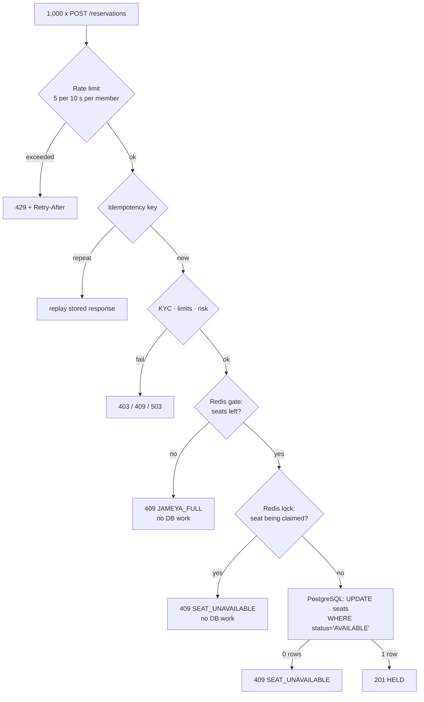

# High Contention: 1,000 Members, One Jameya (Task 3)

**Scenario:** a Jameya opens with 20 seats and 1,000 verified members press Reserve in the same second.

**Goals, in order:** never hold a seat twice · keep the database healthy · tell losers fast · stay fair.

**In short:** cheap Redis checks reject almost everyone before PostgreSQL is touched. PostgreSQL then runs about 20 claims, one per seat, and its conditional `UPDATE` makes the final call. Measured result: **20 holds for 20 seats, 0 double bookings.**

## Request flow



1. **Rate limit** stops one member from flooding; the 1,000 requests come from 1,000 people.
2. **Idempotency** turns network retries into replays, not new attempts.
3. **Gate:** a Redis counter of free seats. At 0, the request is rejected in about 1 ms.
4. **Seat lock:** while seat *n* is being claimed, other requests for *n* are rejected at once. At most one claim per seat reaches PostgreSQL.
5. **PostgreSQL decides.** Even if Redis is wrong or down, the row lock leaves exactly one winner.
6. The Redis counter is updated after commit and rebuilt from PostgreSQL every 10 s.

## Controls

| Layer | Mechanism | If it fails |
|---|---|---|
| PostgreSQL row | Conditional `UPDATE`: one winner per seat | Source of truth |
| PostgreSQL index | Unique live reservation per seat, and per member and Jameya | Source of truth |
| PostgreSQL lock | Advisory lock per member: hold limit can't be raced | Source of truth |
| Redis gate | Free-seat counter | Fails open: PostgreSQL decides |
| Redis seat lock | `SET NX`, 3 s expiry | Fails open: the row lock decides |
| Redis rate limiter | Sliding window per member and per IP | Falls back to a per-instance limiter |

There is no unbounded queue: the number of claims in flight is at most the number of seats, so latency stays flat as demand grows. The database pool (20 per instance) caps database work.

## Fairness vs speed

| Policy | Speed | Fairness | Used? |
|---|---|---|---|
| Everyone hits the database | Slow; the database saturates | Fastest connection wins | No |
| **Redis gate + seat lock** | Fast rejections; database load ≈ seats | Effectively random among near-simultaneous requests; no spamming | **Yes** |
| Waiting room with a lottery | Adds seconds of waiting | Fairest for announced launches | Option for flash sales |
| Lottery after a window | Not real time | Fully fair | Product decision |

A known gap: a request can lose a seat to a competitor whose claim then fails a later check. The seat frees again within milliseconds and the member can retry.

**Waiting room (for very large launches):** members who arrive before opening are shuffled, then admitted at a steady rate with a short-lived signed token. Being 50 ms faster no longer decides who wins. It can be a CDN product or a Redis sorted set; the API only needs one guard that checks the token.

## Failures under load

| Scenario | Behaviour |
|---|---|
| Redis down | Everything reaches PostgreSQL; still exactly one winner per seat, only slower |
| Redis counter stale | May say "full" for up to 10 s after a seat frees. Never oversells |
| PostgreSQL slow | Clients retry with the same key: replay, never a duplicate |
| Instance crashes mid-claim | Transaction rolls back; seat lock expires in 3 s |
| KYC down | Cached members proceed; others get a fast `503` (breaker open) |
| Winners abandon payment | Holds expire after 5 min and the seat is released within 5 s |

## Load test

```bash
docker compose exec backend npm run loadtest:contention
# options: LOADTEST_USERS=1000 LOADTEST_SEATS=20 LOADTEST_MODES=spread,same
```

It creates a fresh 20-seat Jameya and fires 1,000 reservations at the same instant from 1,000 different seeded members. It then checks the database directly and fails if any rule is broken.

- **spread:** 50 members per seat.
- **same:** all 1,000 members want seat 1.

**Results** (single API instance; everything, including the load generator, shares 2 vCPUs):

| Mode | KYC cache | Holds | Rejected | Double bookings | p99 | Throughput |
|---|---|---|---|---|---|---|
| spread | cold | 20 | 894 `JAMEYA_FULL`, 86 `SEAT_UNAVAILABLE` | **0** | 2.4 s | 393 req/s |
| same | cold | 1 | 999 `SEAT_UNAVAILABLE` | **0** | 2.3 s | 420 req/s |
| spread | warm | 20 | 980 `SEAT_UNAVAILABLE` | **0** | 1.6 s | 628 req/s |
| same | warm | 1 | 999 `SEAT_UNAVAILABLE` | **0** | 1.3 s | 727 req/s |

- Every seat was sold, and no hold was orphaned.
- PostgreSQL ran about 20 claim transactions, not 1,000. All other rejections came from Redis.
- Latency comes from 1,000 open connections on 2 shared CPUs, not from lock waits. API instances are stateless, so this scales out.

Integration tests also prove that the database alone is enough: 30 concurrent raw claims that bypass Redis still produce one winner.
