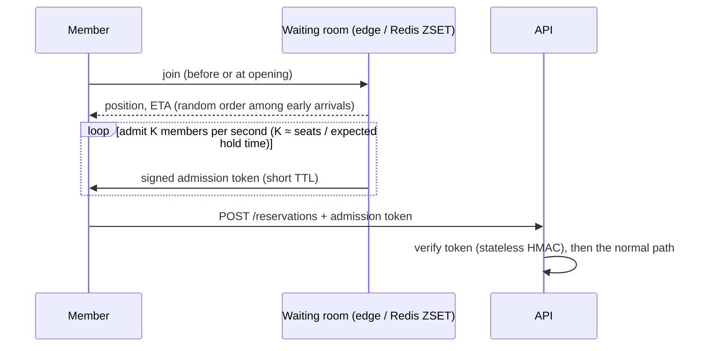

# High Contention: 1,000 Members, One Jameya (Task 3)

**Scenario.** A popular Jameya opens with 20 seats. 1,000 KYC-verified members press "Reserve" in
the same second. Goals, in priority order:

1. **Correctness:** no seat held twice; nobody charged without a seat.
2. **Protection:** the database and the rest of the marketplace stay healthy.
3. **Speed:** losers learn quickly that they lost, without waiting in a queue for a seat that does not exist.
4. **Fairness:** no member can gain an advantage by spamming, and the rules are predictable.

## 1. Request flow under load

```mermaid
flowchart TD
  A[1,000 x POST /reservations] --> B{JWT valid?}
  B -- no --> X1[401]
  B -- yes --> C{Rate limit<br/>5 / 10 s / member<br/>Redis INCR}
  C -- exceeded --> X2[429 + Retry-After]
  C -- ok --> D{Idempotency key<br/>PG INSERT ON CONFLICT}
  D -- replay / in-flight --> X3[stored response / 409]
  D -- new --> E{Eligibility chain<br/>KYC cached · limits · risk}
  E -- fail --> X4[403 / 409 / 503]
  E -- ok --> F{Gate: available counter > 0?<br/>Redis GET}
  F -- no --> X5[409 JAMEYA_FULL<br/>no DB work]
  F -- yes --> G{Seat single-flight lock<br/>SET NX PX 3000}
  G -- busy --> X6[409 SEAT_UNAVAILABLE<br/>no DB work]
  G -- acquired --> H[PG tx: advisory lock(member) ·<br/>UPDATE seats … WHERE status='AVAILABLE' ·<br/>INSERT reservation]
  H -- 0 rows --> X7[409 SEAT_UNAVAILABLE]
  H -- 1 row --> I[COMMIT → DECR counter → 201 HELD]
```

Step by step for one popular Jameya:

1. **Admission.** Each request authenticates (stateless JWT) and passes a per-member rate limit.
   One member cannot fan out many attempts; the 1,000 requests come from 1,000 people.
2. **Idempotency.** Network retries of the same click replay rather than compete again.
3. **Eligibility** is mostly answered from Redis (KYC cache) and short indexed queries. An open KYC
   breaker fails fast instead of stacking requests.
4. **Fast-fail gate.** Once the Jameya's counter reaches 0, every further request is rejected
   with `JAMEYA_FULL` in about 1 ms of Redis time; PostgreSQL never sees it.
5. **Seat single-flight.** While seat *n* has a claim in flight, other requests for *n* are rejected
   immediately (`SEAT_UNAVAILABLE`). At most `#seats` claims are in flight against PostgreSQL at once,
   no matter how many members click.
6. **Authoritative claim.** The conditional `UPDATE` decides. Even if Redis were wrong or down, two
   claims on one row serialise on the row lock and the loser matches 0 rows.
7. **Commit, then adjust the counter.** The counter is non-authoritative and is rebuilt from
   PostgreSQL every 10 s.

## 2. Concurrency control summary

| Layer | Mechanism | Guarantees | If it fails |
|---|---|---|---|
| PostgreSQL row | Conditional `UPDATE … WHERE status='AVAILABLE'` | One winner per seat | n/a (source of truth) |
| PostgreSQL index | `reservations_live_seat_uq`, `reservations_active_user_jameya_uq` | No second live reservation per seat / member+Jameya | n/a |
| PostgreSQL advisory lock | `pg_advisory_xact_lock(member)` | Hold limit cannot be raced | n/a |
| Redis counter | `GET` gate, `INCRBY` after commit, 10 s rebuild | Cheap rejection when full | Fail open → DB decides |
| Redis seat lock | `SET NX PX 3000` + owner-checked `DEL` | ≤ 1 in-flight claim per seat | Fail open → row lock serialises |
| Redis rate limiter | Lua `INCR`+`PEXPIRE` fixed window | ≤ 5 attempts / 10 s / member | Fail open (DB still protected by gate/locks) |

## 3. Rate limiting and queuing

* **Per member:** 5 reservation attempts / 10 s and 5 logins / min / IP. `429` always carries `Retry-After`.
* **Per Jameya:** the gate and single-flight lock act as a natural concurrency limit (≤ seats
  in flight). There is no unbounded queue, so latency stays flat as demand grows.
* **Global:** the DB pool (`DB_POOL_MAX`, default 20 per instance) bounds DB concurrency; Node's
  event loop queues the rest. In production, add a per-route concurrency limit at the load
  balancer/ingress as a circuit for the whole API.

### Scale-up option: virtual waiting room
For flash sales (for example 50,000 members for a celebrity Jameya at 20:00), put a **virtual
waiting room** in front of `POST /reservations` for that Jameya only:



* Members who arrive before opening are **shuffled** (a lottery), so being 50 ms faster does not
  decide who gets the seat. Later arrivals are FIFO.
* The admission rate is tuned so admitted members have a realistic chance. It is also paused
  automatically when the gate says the Jameya is full ("sold out" page instead of a queue).
* Implementation options: Cloudflare/Akamai waiting room, AWS-hosted queue-it, or a Redis
  sorted set (`ZADD NX score=random|time`) + `ZPOPMIN` admitter + HMAC tokens. The API change is
  small: one guard that validates the token for flagged Jameyas.

## 4. Fairness vs speed

| Policy | Speed | Fairness | Our choice |
|---|---|---|---|
| First-come-first-served at the DB (no gate) | Slowest under load (row-lock convoy, DB saturation) | Rewards the lowest latency | No |
| Fast-fail gate + single-flight (current) | Very fast rejections; DB load ≈ #seats | Effectively random among requests that arrive in the same few ms; per-member rate limit prevents spam | **Yes (default)** |
| Waiting room with lottery for early arrivals | Adds seconds of queueing | Fairest for scheduled launches | Scale-up option for announced drops |
| Allocation by lottery after a window (no live booking) | Not real time | Fully fair | A product decision, not used |

Known unfairness in the default path: a request can lose a seat to a competitor whose claim then
fails a later check (for example a hold-limit race). The window is milliseconds, the seat returns
to `AVAILABLE` immediately, and the member can retry. We accept this to keep PostgreSQL protected.

## 5. Failure scenarios under contention

| Scenario | Behaviour |
|---|---|
| Redis down | Gate and rate limiter fail open; every request reaches PostgreSQL; still exactly one winner per seat (row lock). Latency rises; alert fires. |
| Redis counter stale (says full but seats were released) | `JAMEYA_FULL` for up to 10 s until the rebuild; the listing shows availability (≤ 5 s stale). Bounded false negatives, never oversell. |
| PostgreSQL slow | Pool waits grow; requests time out at the client and retry with the **same** idempotency key → replay or `IDEMPOTENCY_IN_PROGRESS`, never duplicates. |
| Instance crash during a claim | The transaction rolls back; the seat lock expires in 3 s; the idempotency key is taken over after its 60 s lease. |
| KYC vendor down during the rush | Members with a cached verification proceed; others get `503 KYC_UNAVAILABLE` quickly (breaker open), so no thread pile-up. |
| Client retries storm | Per-member rate limit + idempotency replay. |
| Winners abandon payment | Holds expire after 5 min; the sweeper releases seats within 5 s; the counter is incremented; others can book. Abandoners are penalised after 3 expiries. |

## 6. Load test results

Command (inside the running backend container, so the same network and secrets as production compose):

```bash
docker compose exec backend npm run loadtest:contention
# env knobs: LOADTEST_USERS (1000), LOADTEST_SEATS (20), LOADTEST_MODES (spread,same)
```

What it does (`backend/src/cli/loadtest-contention.ts`): it creates a fresh 20-seat Jameya, mints
JWTs for 1,000 distinct seeded members (`loadtest+N@pokunity.app`, KYC VERIFIED), and fires 1,000
`POST /reservations` **at the same instant** (`Promise.all`). In `spread` mode member *i* asks for
seat `(i mod 20)+1`, so 50 members compete for each seat. In `same` mode all 1,000 ask for seat 1. It
then checks the database directly and cancels the holds. The process exits non-zero if any invariant fails.

Environment: Docker Desktop VM with **2 vCPUs**, 5 GB RAM (host Apple M3 Pro). API, PostgreSQL,
Redis, **and the load generator** all share those 2 vCPUs, so latency figures are pessimistic.
Single API instance, DB pool 20.

**Run 1: cold KYC cache** (first booking of each member triggers a simulated KYC call, 40–160 ms):

```
=== 1000 users -> 1 Jameya (20 seats), mode=spread ===
outcome                                count
201 HELD                                   20
409 JAMEYA_FULL                           894
409 SEAT_UNAVAILABLE                       86
latency ms  p50   1629  p95   2313  p99   2410  max   2469
wall time 2544 ms, throughput 393 req/s
invariants:
  seatsWithMultipleLiveReservations    0
  heldReservations                     20
  heldSeats                            20
  orphanSeats                          0
  availableSeats                       0
  apiHolds201                          20
  expectedHolds                        20
  PASS                                 true

=== 1000 users -> 1 Jameya (20 seats), mode=same ===
outcome                                count
201 HELD                                    1
409 SEAT_UNAVAILABLE                      999
latency ms  p50   2258  p95   2302  p99   2304  max   2382
wall time 2382 ms, throughput 420 req/s
invariants:
  seatsWithMultipleLiveReservations    0
  heldReservations                     1
  heldSeats                            1
  orphanSeats                          0
  availableSeats                       19
  apiHolds201                          1
  expectedHolds                        1
  PASS                                 true
```

**Run 2: warm KYC cache:**

```
=== 1000 users -> 1 Jameya (20 seats), mode=spread ===
201 HELD                                   20
409 SEAT_UNAVAILABLE                      980
latency ms  p50   1478  p95   1494  p99   1586  max   1590
wall time 1592 ms, throughput 628 req/s
  seatsWithMultipleLiveReservations    0
  apiHolds201                          20
  PASS                                 true
=== 1000 users -> 1 Jameya (20 seats), mode=same ===
201 HELD                                    1
409 SEAT_UNAVAILABLE                      999
latency ms  p50   1248  p95   1310  p99   1311  max   1375
wall time 1375 ms, throughput 727 req/s
  seatsWithMultipleLiveReservations    0
  apiHolds201                          1
  PASS                                 true
```

For reference, the same test on the host (API and generator on the M3 Pro, PostgreSQL/Redis in
Docker) ran spread mode in 915 ms (p99 850 ms) and same mode in 693 ms (p99 671 ms), also with zero
double bookings.

### Reading the results
* **Zero double bookings** in every run: exactly 20 holds for 20 seats (spread) and exactly 1 for
  one seat (same), confirmed against PostgreSQL, with no orphan HELD seats.
* **Every seat was sold** in spread mode. The fast-fail mechanisms did not strand inventory.
* **Where losers were rejected.** In the cold run, KYC latency spread arrivals out, so most
  late requests saw the counter at 0 (`JAMEYA_FULL`, Redis only). In the warm run, all 1,000
  reached the gate before any claim committed. The counter was still 20, so the per-seat
  single-flight lock rejected the 980 losers (`SEAT_UNAVAILABLE`, Redis only). Either way,
  PostgreSQL executed about 20 claim transactions, not 1,000.
* Latency is dominated by the event loop working through 1,000 simultaneous connections on 2
  shared vCPUs (including the generator itself), not by lock waits. Throughput scales horizontally:
  API instances are stateless, and the gate and locks are shared in Redis.

### Related integration tests
`backend/test/booking-concurrency.e2e-spec.ts`: 50 concurrent members on one seat through the API;
30 concurrent raw DB claims **bypassing Redis** (proves the DB alone is sufficient); the partial
unique index; concurrent hold-limit enforcement.
