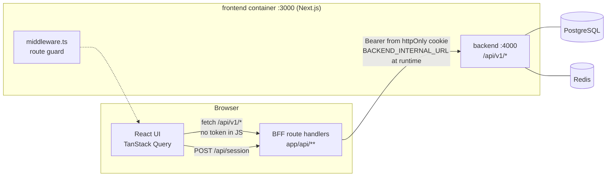

# Frontend Architecture

The Pokunity web app is a Next.js 15 (App Router) client over the frozen API contract in
[`docs/api/`](../api/README.md). The browser never talks to the backend directly: a
Backend-for-Frontend (BFF) inside the same Next.js server proxies `/api/v1/*`, holds the JWT in an
httpOnly cookie, and forwards idempotency and tracing headers unchanged.

## 1. System context



## 2. Folder structure

```
frontend/
  app/                     Thin App Router layer: pages compose features, nothing else
    (app)/                 Signed-in pages (route group, shares header + sign-out)
    login/                 Public sign-in page
    api/v1/[...path]/      BFF catch-all proxy (runtime backend URL)
    api/session/           BFF login / logout (httpOnly cookie)
    providers.tsx          QueryClient, analytics lifecycle, dev mock gate
  middleware.ts            Redirects to /login without a session cookie
  src/
    features/              Vertical slices (see §3)
      auth/ marketplace/ jameya-detail/ reservations/ checkout/ analytics/
        api/               Query/mutation hooks and repositories (transport only)
        model/             Types, mappers, pure logic (fully unit-tested)
        components/        Presentational and container components
        hooks/             Feature hooks that compose api + model
        index.ts           The only public surface of the feature
    shared/                Leaf layer; imports nothing from features/
      api-client/          Adapter over fetch with typed errors and zod validation
      contract/            zod schemas mirroring docs/api/openapi.yaml
      query/               Query-key factory and QueryClient policy
      config/              Env, timing policy, routes
      lib/                 money, time, uuid, idempotency registry, observers
      ui/                  Design-system primitives (Button, Alert, ErrorBoundary, ...)
    server/bff/            Server-only: cookie, proxy, login/logout, header policy
    mocks/                 MSW handlers, fixtures and an in-memory backend (tests + dev mode)
    test/                  Vitest setup, render helper, next/navigation double
```

## 3. Feature modules

| Feature | Owns | Depends on (via `index.ts`) |
|---|---|---|
| `auth` | Login, logout, `/me`, KYC banner and copy | shared |
| `marketplace` | Ranked list, featured carousel, URL filters, sort strategies, impression tracking | `analytics` |
| `jameya-detail` | Detail, seat map, optimistic reserve, seat-level error handling | `marketplace`, `reservations`, `checkout`, `analytics` |
| `reservations` | Reservation repository, status grouping, poll policy, error strategy, lists | shared |
| `checkout` | Checkout state machine, payment method picker, pay/release, outcomes | `reservations`, `analytics` |
| `analytics` | Event builder, batcher, impression ledger, page-hide flush | shared |

The dependency graph is acyclic: `analytics` and `reservations` are leaves, `checkout` depends on
`reservations`, and `jameya-detail` sits at the top.

## 4. Enforced boundaries

Boundaries are enforced by ESLint, so a violation fails `npm run lint` rather than review:

| Rule | Mechanism |
|---|---|
| No deep feature imports (`@/features/x/y`) | `no-restricted-imports` with `@/features/*/*` and `**/features/*/*/**` |
| `shared/` never imports a feature | `no-restricted-imports` scoped to `src/shared/**` |
| No function, component, hook, arrow or test callback block over 15 lines, in any file | `max-lines-per-function` (`max: 15`, blank lines and comments skipped, IIFEs counted) |
| No `any` | `@typescript-eslint/no-explicit-any` |
| Accessibility baseline | `eslint-plugin-jsx-a11y` recommended |

The 15-line limit applies to test and mock code too; see [development.md](development.md#lint-rules).

## 5. Authentication and the BFF

```mermaid
sequenceDiagram
  participant B as Browser
  participant M as middleware.ts
  participant S as BFF /api/session
  participant P as BFF /api/v1/*
  participant A as Backend
  B->>M: GET /reservations (no cookie)
  M-->>B: 307 /login?next=/reservations
  B->>S: POST /api/session {email, password}
  S->>A: POST /api/v1/auth/login
  A-->>S: {accessToken, expiresIn, user}
  S-->>B: 200 {user, expiresIn} + Set-Cookie pokunity_session (httpOnly, SameSite=Lax)
  B->>P: GET /api/v1/jameyas (cookie sent automatically)
  P->>A: GET /api/v1/jameyas + Authorization: Bearer <cookie value>
  A-->>P: 200 (+ Cache-Control)
  P-->>B: 200 (headers relayed; token never sent to the browser)
  Note over P,B: Backend 401 with a token: BFF clears the cookie, UI redirects to /login?reason=expired
```

Key decisions:

- **The JWT never reaches client JavaScript.** It is set as an httpOnly cookie by the login route,
  read only on the server, and attached as `Authorization` by the proxy.
- **`SameSite=Lax` plus a same-origin BFF** removes the cross-site request path for state changes.
  `Secure` is set under HTTPS; `COOKIE_SECURE` overrides it for TLS-terminating proxies.
- **Client-controlled `Authorization` is ignored.** Only `Accept`, `Content-Type` and
  `Idempotency-Key` cross the boundary, plus `X-Request-Id` (generated if absent).
- **Response policy:** status, `Retry-After`, `Idempotent-Replayed`, `X-Request-Id` and body are
  relayed unchanged. Hop-by-hop headers, `set-cookie` and encoding headers are dropped.
- **Provider callbacks are blocked at the BFF.** `POST /api/v1/payments/webhook` returns 404 here;
  the provider calls the backend directly and is authenticated by HMAC.
- **One backend client.** Every backend call (proxy, login, server prefetch) goes through
  `backend-client.ts`: keep-alive pool, 10 s timeout, and a circuit breaker that fails fast with
  `Retry-After` when the backend is unhealthy. Details and numbers are in
  [performance/frontend.md](../performance/frontend.md#5-bff-resilience).
- **Runtime configuration.** `BACKEND_INTERNAL_URL` is read per request, so one image runs in any
  environment. This is why the proxy is a route handler and not a `next.config` rewrite (rewrites
  are baked in at build time).

## 6. Data flow and state management

| State | Where it lives | Why |
|---|---|---|
| Server data (jameyas, seat map, reservations) | TanStack Query cache | Staleness, retries, dedupe, background refetch |
| Checkout lifecycle | `useReducer` state machine (`checkout-machine.ts`) | Explicit legal transitions; terminal states are sticky |
| Filters | URL search params | Shareable, back-button safe, survive reloads |
| Form drafts, selection | Component state | Local, short-lived |
| Idempotency keys | Module registry (`shared/lib/idempotency.ts`) | One key per user intent, reused across automatic retries |
| Analytics queue | Module singleton (`analytics`) | Batching across page transitions |
| Marketplace data | Server prefetch, hydrated into TanStack Query | First paint has data; no request waterfall after hydration |

Every API response is parsed by a zod schema in `shared/contract/schemas.ts` at the client boundary.
A response that does not match becomes a `ContractError` rather than malformed data in the UI.

### Query options as the single source of truth

Each read is a factory (`jameyaListOptions`, `featuredOptions`, `jameyaDetailOptions`, `meOptions`)
that returns the key, the function and the policy. The server prefetch and the client hooks call the
same factory, so the hydrated cache entry is exactly the one the client looks up. The client is
injectable: the browser uses `apiClient`, the server uses a client bound to the viewer's cookie.

## 7. Design patterns

| Pattern | Where | Purpose |
|---|---|---|
| Adapter | `shared/api-client` (`HttpTransport` port, `createApiClient`) | Isolates fetch; typed success and errors |
| Repository | `features/*/api/*-repository.ts` | Transport only; hooks own caching and policy |
| Query-hook per resource | `use-jameya-list`, `use-reservation`, `use-me`, ... | One cache policy per resource |
| Factory | `shared/query/keys.ts` | Consistent keys so invalidation is precise |
| Container / Presentational | `*View` / `*Body` / `*Card` components | Logic separated from markup; markup is testable |
| Strategy | `sort-options.ts`, `badges.ts`, `error-strategy.ts`, `outcome-copy.ts` | Per-option behavior in one table; exhaustive records |
| State machine | `checkout/model/checkout-machine.ts` | Pure reducer; the server status is replayed into it |
| Observer | `shared/lib/use-intersection.ts` (impressions, infinite scroll) | Visibility without polling |
| Retry policy | `shared/api-client/retry.ts`, `backoff.ts` | Retry only what is not definitive; jittered backoff; honour `Retry-After` |
| Circuit breaker | `server/bff/circuit-breaker.ts` | Fail fast when the backend is unhealthy; one probe to recover |
| Rate gate | `shared/api-client/rate-gate.ts` | Hold writes locally for the server's `Retry-After` |

## 8. Related documents

- [Development guide](development.md): scripts, lint, tests, mock mode, Docker.
- [Edge cases](edge-cases.md): each failure mode, the UX response, and where it lives in code.
- [Stale data and optimistic UI](../marketplace/stale-data-and-optimistic-ui.md).
- [Marketplace UX strategy](../marketplace/ux-strategy.md) and [A/B testing](../marketplace/ab-testing.md).
