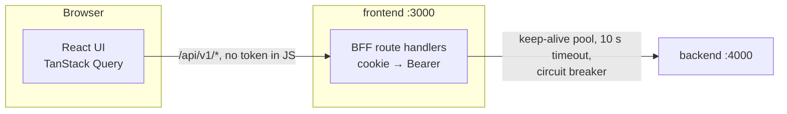
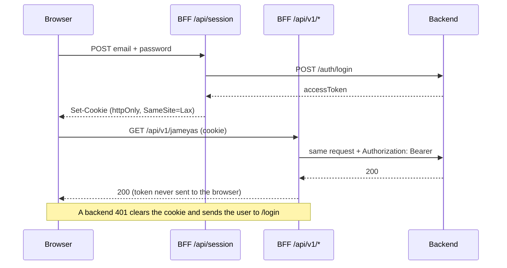

# Frontend Architecture

Next.js 15 (App Router) over the [API contract](../api/README.md). **The browser never calls the backend directly:** a BFF inside the Next.js server forwards `/api/v1/*` and keeps the JWT in an httpOnly cookie.



## Folders

```text
frontend/
  app/                 pages only: compose features
    api/v1/[...path]/  BFF proxy
    api/session/       login / logout (sets the cookie)
  middleware.ts        no cookie → /login
  src/
    features/          auth, marketplace, jameya-detail, reservations, checkout, analytics
      <feature>/       api/ (requests) · model/ (pure logic) · components/ · hooks/ · index.ts
    shared/            api-client, contract (zod), query, ui, lib — never imports features
    server/bff/        cookie, proxy, breaker (server only)
    mocks/             MSW mock backend for tests and mock mode
```

## Features

| Feature | Owns | Uses |
|---|---|---|
| `auth` | Login, logout, `/me`, KYC banner | – |
| `marketplace` | List, featured, URL filters, impressions | analytics |
| `jameya-detail` | Seat map, optimistic reserve | marketplace, reservations, checkout, analytics |
| `reservations` | Reservation data, polling, error copy | – |
| `checkout` | Checkout state machine, pay and release | reservations, analytics |
| `analytics` | Event batching | – |

ESLint enforces the boundaries: features are imported only through `index.ts`, `shared/` never imports a feature, and every function, component and test is at most 15 lines.

## Session and BFF



- **The JWT never reaches JavaScript.** Only the server reads the cookie.
- **Only safe headers cross:** `Accept`, `Content-Type`, `Idempotency-Key`, `X-Request-Id`. A client-sent `Authorization` is ignored.
- **The webhook path is blocked** at the BFF; the provider calls the backend directly.
- **Configured at runtime:** `BACKEND_INTERNAL_URL` is read per request, so one image works everywhere.
- **Logout** calls the backend, clears the cookie, the query cache, the browser HTTP cache and the analytics queue. If the backend is down, the member is still signed out locally.

## State

| State | Lives in |
|---|---|
| Server data | TanStack Query (prefetched on the server, hydrated in the browser) |
| Checkout progress | Reducer state machine; final states can't be left |
| Filters | URL |
| Idempotency keys | One per user action, reused on retries |
| Analytics queue | Module singleton, flushed every 5 s or 20 events |

Every response is validated by a zod schema. A mismatch becomes a contained `ContractError`, never bad data on screen.

## Patterns

| Pattern | Where |
|---|---|
| Adapter | `shared/api-client`: typed errors, retries, `Retry-After` |
| Repository + query hook | `features/*/api`: one cache policy per resource |
| Container / presentational | `*View` holds logic, `*Card` / `*Body` hold markup |
| Strategy | Sort options, badges, error copy as lookup tables |
| State machine | Checkout |
| Circuit breaker | BFF → backend |
| Observer | Intersection observer for impressions and infinite scroll |

More: [development](development.md) · [edge cases](edge-cases.md) · [stale data](../marketplace/stale-data-and-optimistic-ui.md) · [performance](../performance/frontend.md)
