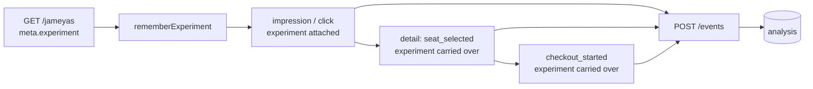

# A/B Testing the Marketplace Ranking

The contract attaches an `experiment` (`key`, `variant`) to every list response (`meta.experiment`),
and the frontend echoes it on every analytics event. This document defines how an experiment is run,
read, and decided. The current example is `ranking_v2` (`control` vs `treatment`).

## 1. How assignment and attribution work

1. **Assignment is server-side.** The backend chooses the variant per member (stable across sessions)
   and returns it in `meta.experiment`. The frontend never assigns variants.
2. **The frontend attributes events.** `MarketplaceView` remembers the latest list assignment
   (`analytics.rememberExperiment`). Impressions and clicks from the list, and seat and checkout
   events from the detail and checkout pages, carry the same `experiment` object.
3. **Surfaces are labelled.** `surface` is `marketplace_list`, `featured_carousel`, or `jameya_detail`,
   and `position` is the 1-based rank across loaded pages.

Events with no list context (for example, a detail page opened directly from an email) have no
experiment. They are excluded from the variant analysis and counted in a separate
"unattributed" segment, so they cannot bias either arm.

## 2. Events and funnel definition

| Event | Fired by | Key fields |
|---|---|---|
| `impression` | `useImpression`, once per item per page view, at >= 50% visible | `jameyaId`, `surface`, `position`, `experiment` |
| `click` | Card link | `jameyaId`, `surface`, `position`, `experiment` |
| `seat_selected` | Seat radio change | `jameyaId`, `surface: jameya_detail` |
| `checkout_started` | Pay click | `jameyaId`, `surface: jameya_detail` |
| Server: `reservation_created`, `reservation_confirmed` | Backend | Source of truth for the outcome metric |

Impressions are deduplicated per item per page view, so a member scrolling back and forth does not
inflate exposure. Events are batched (5 s or 20 events, and on page hide), so the analysis tolerates
a few seconds of loss at unload.

## 3. Metrics

**Primary metric:** *confirmed-reservation conversion per session* (for example, sessions with at
least one `reservation_confirmed` / sessions with at least one list impression in the experiment).

Why this metric: it is the business outcome (a confirmed seat), it is per session so that repeated
browsing is not double-counted, and it is measured server-side, so it is not affected by client
analytics loss.

**Secondary metrics (diagnostics):**

- Click-through rate: clicks / impressions, by position.
- Hold rate: `reservation_created` / clicks on a detail page.
- Checkout start rate: `checkout_started` / holds.
- Time to first seat selection.

**Guardrails (must not get worse):**

| Guardrail | Why it matters | Stop if |
|---|---|---|
| Hold-expiry rate (holds that expire unpaid) | Measures people holding seats they do not intend to pay for, which is a trust and capacity cost | Treatment is more than 2 percentage points above control, with a significance test |
| Payment failure rate (`FAILED` / `PAYMENT_PENDING` outcomes) | Ranking must not push members toward seats or amounts that fail to pay | Treatment is significantly higher |
| Reservation release rate (`CANCELLED` by member) | Regret signal | Significantly higher in treatment |
| Fee-to-payout ratio of confirmed seats | A ranking that favours expensive seats for conversion is a fairness and regulatory concern | Shift is material and unexplained |
| Restriction/KYC error rate | Ranking changes must not expose restricted seats | Any increase |
| p95 list latency | Ranking v2 must stay inside the 5 s freshness budget | Above the budget |

## 4. Sample size and duration

- Choose the minimum detectable effect (MDE) on the primary metric before starting, for example
  a relative lift of 5%.
- With a baseline conversion of 8% and a two-sided test (alpha 0.05, power 0.8), the required sample is
  roughly 74,000 sessions per arm. Recompute with the real baseline from the last four weeks.
- **Duration:** run for at least two full weeks, so weekday and weekend behavior, and salary cycles
  (the member's monthly contribution timing) are both represented. Prefer three weeks when the
  traffic is not yet enough to reach the sample in two.
- Never stop because the result "looks good" on day three. Use a pre-registered stopping rule.

## 5. Randomization and integrity checks

- **Unit of randomization:** the member (account), not the session, so one person does not see both
  rankings.
- **Sample ratio mismatch (SRM):** before reading any result, check that the arm split matches the
  design (for example, 50/50). A chi-square test with p < 0.001 means assignment or logging is broken,
  and the result is void until it is fixed.
- **Exposure check:** impressions per arm should be similar. A large difference means the variant
  changes what is rendered (for example, empty lists), which is a bug, not a result.
- **Attribution check:** the share of events without an experiment should be the same in both arms.

## 6. Analysis plan and avoiding peeking

- Pre-register the primary metric, the MDE, the sample, the duration, and the guardrails in a
  one-page doc before the experiment starts.
- Look at guardrails daily (they are safety checks, and they may stop an experiment early).
- Do not look at the primary metric until the planned sample is reached, or use a sequential method
  with alpha spending if an early read is required. Report the method used.
- Report the absolute and relative lift with a confidence interval, not only a p-value.

## 7. Segments

Analyse by segment, but treat segment results as hypotheses, not decisions:

- Risk tier (LOW / MEDIUM / HIGH) and KYC status. Ranking must not work differently for members
  who are restricted for regulatory reasons.
- Typical monthly amount (`preferences.typicalMonthlyAmount`) against the amount shown.
- New versus returning members.
- Mobile versus desktop (layout changes affect position visibility).

Any segment result that is not pre-declared needs confirmation in a follow-up experiment.

## 8. Decision rules

| Outcome | Decision |
|---|---|
| Primary metric significantly up, all guardrails pass | Ship treatment; watch guardrails for two weeks after rollout |
| Primary up, a guardrail fails | Do not ship as is. Investigate the guardrail first (it may be a fairness or trust problem) |
| Primary flat, guardrails pass, secondary metrics up | Do not ship on secondary metrics alone. Consider a longer test or a larger MDE |
| Primary down | Stop treatment. Record the learning |
| SRM or exposure bug | Void the experiment. Fix the cause and restart |

Every decision is recorded with the pre-registered doc, the final sample, the results, and the
guardrail review, so the next experiment starts from evidence.

## 9. Rollout

1. Start at 10% of members in each arm, for the first 48 hours, to catch errors.
2. Move to 50/50 once the SRM and exposure checks pass.
3. Keep the experiment running for the full planned duration.
4. Once shipped, keep a 5% holdout for one more month to measure the long-term effect.
