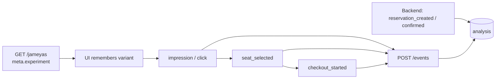

# A/B Testing the Ranking (Task 2, optional)

Current experiment: `ranking_v2`, with `control` (no personal signals) and `treatment` (personalised). The weights are in [ranking](ranking-and-personalization.md#score-and-weights).

## Assignment and attribution

- **Server assigns** by hashing the member id: stable, needs no storage, the same on every instance. The UI never picks a variant.
- **Unit is the member**, not the session, so one person never sees both rankings.
- The UI attaches the variant to every event. Events with no list context, such as deep links, are reported separately.
- Impressions count once per item per page view, at 50% or more visible.

## Metrics

**Primary:** confirmed-reservation conversion per session (sessions with a `reservation_confirmed` ÷ sessions with an impression). It is the business outcome, and the server measures it, so it doesn't suffer from client analytics loss.

**Secondary:** click-through by position · hold rate · checkout start rate · time to first seat.

**Guardrails** (stop or block shipping if worse):

| Guardrail | Why |
|---|---|
| Holds that expire unpaid | Holding without intent costs trust and inventory |
| Payment failure rate | Ranking must not push members into seats they can't pay for |
| Member cancellations | Regret signal |
| Fee-to-payout ratio of confirmed seats | Favouring expensive seats is a fairness and regulatory risk |
| KYC or restriction errors | Restricted seats must not surface |
| p95 list latency | Must stay inside the 5 s freshness budget |

## Running it

1. **Pre-register** the primary metric, minimum detectable effect, sample size, duration and guardrails.
2. **Sample:** at 8% baseline conversion and a 5% relative lift (α 0.05, power 0.8), about 74,000 sessions per arm.
3. **Duration:** at least 2 full weeks, to cover weekdays, weekends and salary cycles.
4. **Rollout:** 10% for 48 h, then 50/50, then keep a 5% holdout for a month after shipping.
5. **No peeking:** check guardrails daily; read the primary metric only at the planned sample, unless using a sequential method.

## Integrity checks (before reading results)

- **Sample ratio mismatch:** the split must match the design (chi-square p < 0.001 → result is void).
- **Exposure:** impressions per arm should be similar.
- **Attribution:** the share of unattributed events should be equal in both arms.

## Segments

Risk tier and KYC status · usual monthly amount · new vs returning · mobile vs desktop. Segment findings are hypotheses for a follow-up test, not decisions.

## Decision rules

| Outcome | Decision |
|---|---|
| Primary up, guardrails pass | Ship; watch guardrails for 2 weeks |
| Primary up, a guardrail fails | Don't ship; investigate first |
| Primary flat, secondary up | Don't ship on secondary metrics alone |
| Primary down | Stop; record what was learned |
| Ratio mismatch or exposure bug | Void, fix, restart |
