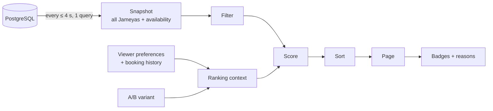

# Ranking and Personalization (Task 2)

**In short:** every few seconds the backend loads all Jameyas into memory. Each request then filters, scores and sorts that in-memory list for the viewer. Scores mix six signals; the A/B variant decides the weights. Code: `backend/src/modules/catalog/domain/ranking/`.

## Pipeline

1. **Snapshot:** all Jameyas with seats left and fee range, refreshed when older than 4 s. Data is at most about 5 s old.
2. **Viewer:** declared monthly amount and durations. If no amount was declared, the average of past confirmed bookings is used.
3. **Filter:** amount range, duration, name search, available only.
4. **Score and sort:** `id` breaks ties, so pages stay stable.
5. **Present:** badges and up to 3 plain-language reasons.

## Signals

Each signal is scaled to 0–1.

| Signal | Meaning | Personal? |
|---|---|---|
| `amountMatch` | How close the monthly amount is to the viewer's usual amount | yes |
| `durationMatch` | How close the duration is to a preferred duration | yes |
| `scarcity` | Share of seats already taken | no |
| `startingSoon` | 1 if starting within 14 days, falling to 0 at 120 days | no |
| `freshness` | Newly listed, falling to 0 after 30 days | no |
| `featured` | In an active marketing campaign | no |

## Score and weights

`score = Σ weight × signal`. Each variant's weights sum to 1, so scores stay between 0 and 1.

| Signal | `control` | `treatment` (personalised) |
|---|---|---|
| amountMatch | 0 | **0.35** |
| durationMatch | 0 | **0.20** |
| scarcity | 0.35 | 0.15 |
| startingSoon | 0.30 | 0.15 |
| freshness | 0.15 | 0.05 |
| featured | 0.20 | 0.10 |

**Reasons** are the strongest contributions turned into text, at most 3. For example: "Matches your usual monthly amount", "Only 2 seats left", "Starts in 12 days". Control never shows personal reasons.

**Badges** (independent of the score):

| Badge | When |
|---|---|
| `FEATURED` | In an active campaign |
| `ALMOST_FULL` | ≤ 2 seats or ≤ 20% left |
| `STARTING_SOON` | Starts within 30 days |
| `NEW` | Listed in the last 7 days |
| `BEST_MATCH` | Treatment only: amount and duration both match |

## Experiments

- **Assignment:** hash of `ranking_v2:` + member id, split 50/50. Deterministic, sticky, needs no storage.
- **Strategy pattern:** a variant is a weight table, so a new variant is a table plus a percentage.
- Returned as `meta.experiment`. How the test is run and read: [A/B testing](ab-testing.md).

## Featured campaigns

Marketing schedules campaigns in `featured_campaigns` (start, end, priority) without a deploy.

- `GET /jameyas/featured`: up to 10 active, non-full Jameyas by priority.
- In the main list, `featured` is a signal and a badge, **not a pin**. A featured but poorly matching Jameya doesn't push out relevant ones.

## Freshness

| Data | Max age | How |
|---|---|---|
| List, featured | ≤ 5 s | Two-tier cache plus ETag ([caching](../performance/caching.md)) |
| Seat map | ≤ 2 s | Cache cleared on every seat change |
| Booking | live | Database only |

## Scale

**Today (5,000 Jameyas):** the snapshot refresh is one aggregate query (30–60 ms) every 4 s per instance. Scoring 5,000 items in memory takes a few ms and a few MB.

**Beyond 50k Jameyas:**

1. Keep a listing table updated from seat events, instead of re-aggregating seats.
2. Pre-filter the top ~500 in SQL or a search engine by a non-personal score; personalise only those.
3. Share one snapshot through Redis, or move search to OpenSearch.
4. Learn the weights from the experiment data (logistic regression or learning-to-rank).
