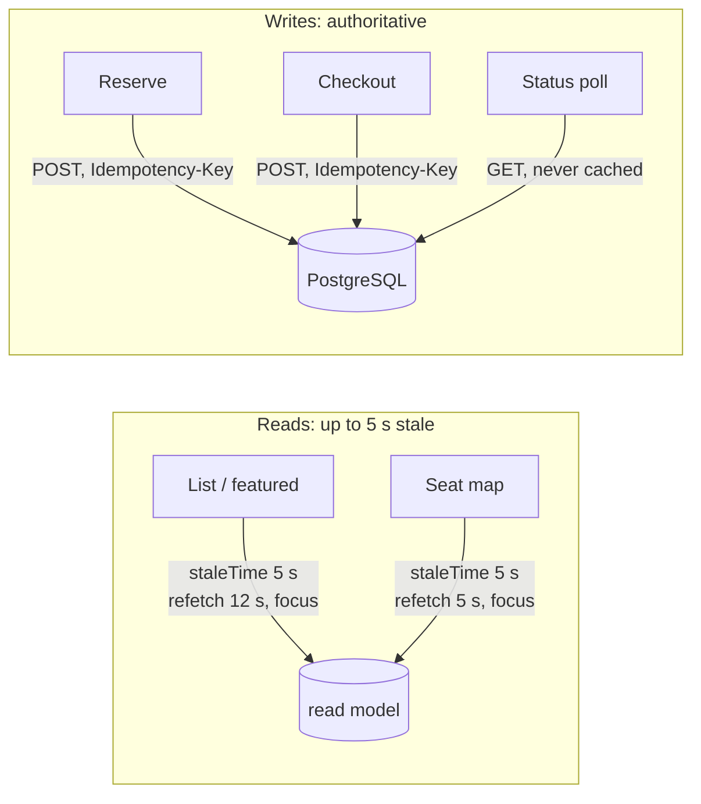
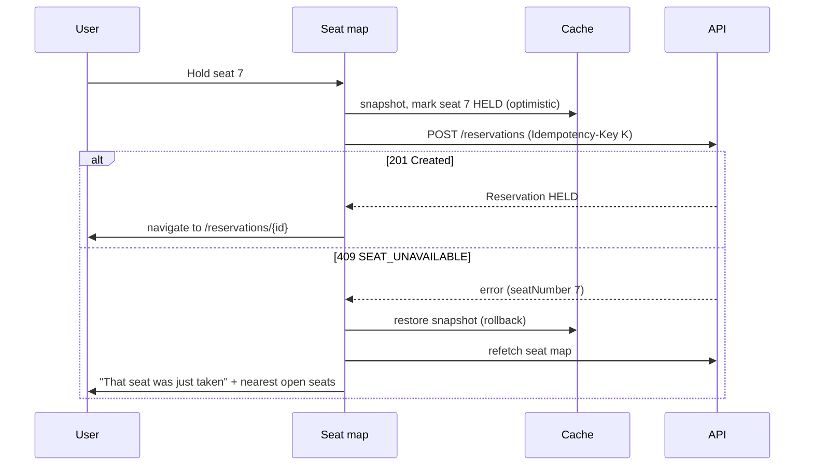

# Stale Data and Optimistic UI

The contract allows marketplace reads to be up to **5 seconds stale**, and requires the booking path
(`POST /reservations`, `POST /reservations/{id}/checkout`) to read the authoritative database. This
document explains how the frontend turns that into behavior: what is shown, how often it refreshes,
when the UI acts before the server answers, and how it recovers.

## 1. Two freshness regimes

| Surface | Source of truth | Freshness mechanism | Max age the user can see |
|---|---|---|---|
| Marketplace list, featured carousel | Read model, cached by the server up to 5 s | `staleTime 5 s`, refetch every 12 s while visible, refetch on focus | About 5 s plus the 12 s refetch window; shown as "Availability updated Xs ago" |
| Seat map on the detail page | Read model | `staleTime 5 s`, refetch every 5 s, refetch on focus | About 5 s |
| Reserve, checkout, reservation status | Database (never cached) | Mutation response plus polling of `GET /reservations/{id}` | Zero: the response itself is authoritative |

The freshness indicator uses the server's `asOf`, not the browser's fetch time. That is the honest
number: it says how old the data is at the source, which is what a user should weigh.

## 2. Why the seat map is still safe to act on

A seat shown as available may be taken a moment later. The UI does not assume the seat map is
current when the user clicks. The authoritative check happens on `POST /reservations`, in the order
the contract defines (KYC, limits, restriction, then the atomic seat claim). A conflict returns
`409 SEAT_UNAVAILABLE`, which the UI handles as described in section 3. So a stale map costs a
retry, never a double booking.

## 3. Optimistic seat hold, with rollback

Reserving is the one place where the UI acts before the server answers, because the wait is
perceptible and the outcome is usually success. The rules:

1. On click, the seat shows **"Holding…"** immediately (the checkout machine moves to `holding`).
2. The seat map snapshot is captured, and the cached seat is marked `HELD` (`markSeatHeld`), so
   other views agree with what the user just did.
3. The request is sent with an `Idempotency-Key` for this intent.
4. On success the user navigates to `/reservations/{id}`, and the seat is re-read.
5. On failure the snapshot is restored (`failReserve`). The seat map is then re-read from the
   server, so the final state is the server's, not the optimistic one.

Retries are part of the same intent. Transport loss, `429 RATE_LIMITED` (honoring `Retry-After`),
`409 IDEMPOTENCY_IN_PROGRESS`, and `5xx` are retried twice with the same key. The optimistic state
stays visible during retries, because the intent has not failed yet.

The seat's key is released only when the outcome is definitive. A business rejection releases it,
so the next click is a new intent. A network failure keeps it, so the user can safely retry the same
intent. Tests cover both (`reserve-flow.test.tsx`).

## 4. Why payment is never optimistic

Payment is the one action where showing success early would lie. The money rules in
`docs/api/reservations.md` mean that the provider only authorizes funds during `PAYMENT_PENDING`, and
the capture happens only after the seat is confirmed. The UI mirrors that:

- A `202 Accepted` from checkout moves the machine to `paying`, and the copy says the payment is being
  authorized. It does not say "Paid" or "Confirmed".
- `CONFIRMED` is reached only from the server: a `200` for a zero-fee seat, or a status poll that
  reads `CONFIRMED`. The state machine has no transition from `paying` to `confirmed` on an event
  the client generates.
- A decline or timeout shows "Your card was not charged", with the authorization explained.

This is verified by tests: a 202 never displays the confirmed message, and the confirmed message
appears only when the server status is `CONFIRMED`.

## 5. Polling policy

Polling is a pure function of the reservation status and time, so its stop condition is tested
directly (`poll-policy.ts`):

| Status | Interval | Stops when |
|---|---|---|
| (not loaded) | 1.5 s | Loaded |
| `HELD` | 5 s (detects sweeper expiry) | Status changes |
| `PAYMENT_PENDING` | 1.5 s for the first 15 s, then 3 s | Status becomes terminal |
| `CONFIRMED`, `EXPIRED`, `CANCELLED`, `FAILED` | Never (`false`) | Terminal |

Polling continues in the background on the checkout page. A payment outcome must not be missed
because the tab was hidden.

## 6. Conflict handling summary

| Response | Client action |
|---|---|
| `409 SEAT_UNAVAILABLE` | Roll back, re-read the seat map, suggest nearest seats |
| `409 ACTIVE_RESERVATION_EXISTS` | Link to the existing hold |
| `409 HOLD_LIMIT_REACHED` | Link to "My reservations" |
| `409 JAMEYA_FULL` | Link to similar Jameyas (same monthly amount) |
| `409 INVALID_STATE` (checkout) | Re-read the reservation, and show the server's status |
| `409 IDEMPOTENCY_IN_PROGRESS` | Retry with the same key |
| `410 RESERVATION_EXPIRED` | Machine moves to `expired`, and the user chooses the seat again |
| `422 IDEMPOTENCY_KEY_REUSED` | Start again. Cannot occur through this UI, because keys are scoped to the intent |
