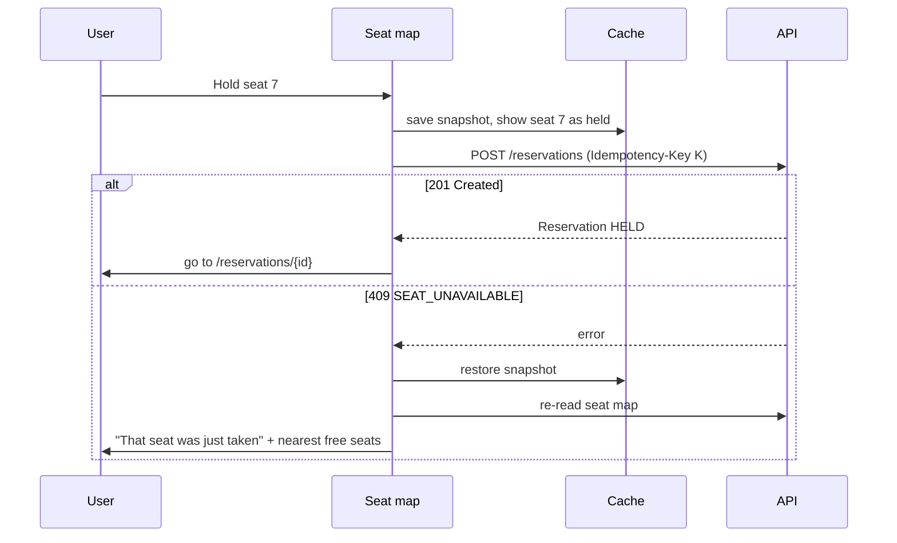

# Stale Data and Optimistic UI (Task 2)

**Rule:** browsing data may be up to 5 s old; booking always reads the database. A stale screen can cost a retry, never a double booking or a false "confirmed".

## Two kinds of freshness

| Screen | Source | Refresh | Oldest data shown |
|---|---|---|---|
| List, featured | Server cache (≤ 5 s) | Every 12 s while visible, and on focus | ~5 s, shown as "updated Xs ago" |
| Seat map | Server cache | Every 5 s, and on focus | ~5 s |
| Reserve, checkout, status | Database | Response, then polling | Live |

"Updated Xs ago" uses the server's `X-As-Of` time, not the browser's fetch time. That is how old the data really is.

**Revalidation:** after 5 s the browser re-asks with `If-None-Match`. If nothing changed, it gets a tiny `304` and keeps its copy; `X-As-Of` still updates the freshness line. Details: [caching](../performance/caching.md).

## Optimistic seat hold, with rollback

Reserving is the one place the UI acts before the server answers: the wait is noticeable and success is likely.

- Network errors, `429`, `409 IDEMPOTENCY_IN_PROGRESS` and `5xx` are retried twice **with the same key**. The seat stays "Holding…" meanwhile.
- A definite rejection releases the key, so the next click is a new attempt.

## Payment is never optimistic

- `202` from checkout shows "Authorizing your payment", never "Paid".
- "Confirmed" appears only when the server says `CONFIRMED`. The UI state machine has no way to reach it on its own.
- Decline or timeout shows "Your card was not charged".

## Polling

| Status | Every | Stops when |
|---|---|---|
| `HELD` | 5 s (to notice expiry) | Status changes |
| `PAYMENT_PENDING` | 1.5 s, then 3 s after 15 s | Final status |
| Final (`CONFIRMED`, `EXPIRED`, `CANCELLED`, `FAILED`) | never | – |

Polling pauses in hidden tabs and refetches immediately when the tab is visible again.

## Conflict handling

| Response | UI action |
|---|---|
| `409 SEAT_UNAVAILABLE` | Roll back, re-read the map, suggest nearby seats |
| `409 ACTIVE_RESERVATION_EXISTS` | Link to the existing hold |
| `409 HOLD_LIMIT_REACHED` | Link to My reservations |
| `409 JAMEYA_FULL` | Show similar Jameyas |
| `409 INVALID_STATE` | Re-read and show the server's status |
| `410 RESERVATION_EXPIRED` | Ask the user to pick the seat again |
