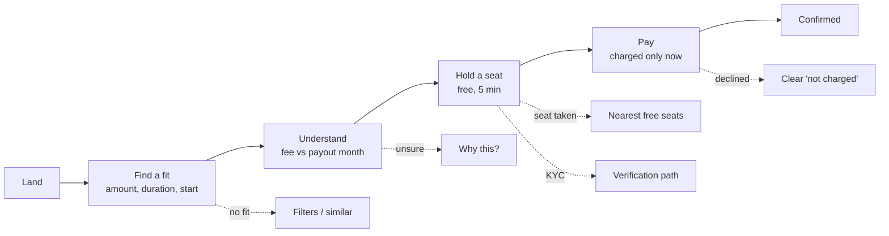

# Marketplace UX Strategy (Task 2)

**Goal:** more **confirmed seats per visit**, without pressure a regulated, trust-based product can't justify. A hold that is never paid counts as a cost, not a win.

## Funnel

Make the fit and the trade-off obvious before the first commitment, and make every failure recoverable.

## What a card shows, in order

1. **Monthly amount and duration**: always first, always with units.
2. **Payout and fee range**: side by side. A range, because the fee depends on the seat.
3. **Start date**: a real date.
4. **Seats left**: a number with a bar.
5. **Why recommended**: server-written reasons under a collapsed "Why this?".

Badges come last, and each one states a fact ("Only 2 seats left", "Starts in 24 days").

## Recommendations

- Default sort is "Recommended for you". Every other sort says in one line what it optimises.
- Reasons come from the server (`ranking.reasons`); the UI never invents them.
- Filters live in the URL, so lists can be shared and the back button works.

## Honest urgency

| Signal | Allowed | Not allowed |
|---|---|---|
| Seats left | Exact server count | Rounded or inflated numbers |
| Hold countdown | Server's `expiresAt` | A timer that resets |
| "Starting soon" | Only from the server badge | Invented deadlines |
| Hold | "Free, lasts a few minutes, charged only when confirmed" | Implying payment is needed to hold |

## Trust

- Every amount shows currency, two decimals and a label ("Seat fee (locked)").
- Every failure says whether money moved ("Your card was not charged").
- Checkout explains authorize-then-capture in one sentence.
- The simulated payment provider is labelled as such.
- "Availability updated 3s ago" shows how current the numbers are.

## KYC states

| State | Message | Still possible |
|---|---|---|
| `VERIFIED` | none | Everything |
| `PENDING` | "Verification in progress. Reserving unlocks once approved." | Browse, compare |
| `REJECTED` | "Verification was not approved." + support link | Browse |
| `UNKNOWN` | "Verification temporarily unavailable." | Browse, retry later |

## Empty and error states

| State | Response |
|---|---|
| No matches | Suggest widening amount or duration |
| Jameya full | Show similar Jameyas |
| Restricted seat | Greyed out, reason in text |
| Hold limit reached | Name the limit; link to My reservations |
| Session ended | Explain, then return to the same page after login |
| Payment pending | "Confirming your payment", with the latest expected time |

## Accessibility

- Seat map is a radio group: one tab stop, arrow keys, Space to select. Disabled seats say why.
- Status changes are announced politely; errors use `role="alert"`.
- Colour is never the only signal. Touch targets are at least 44 px.
- No auto-rotating carousel. Mobile-first, with no horizontal page scroll.

## Deliberately not done

- No fake scarcity, no "X people viewing", no resetting timers.
- No pre-selected payment that moves money.
- Releasing a hold is one click.
- No personalisation that hides the fee or the payout timing.
