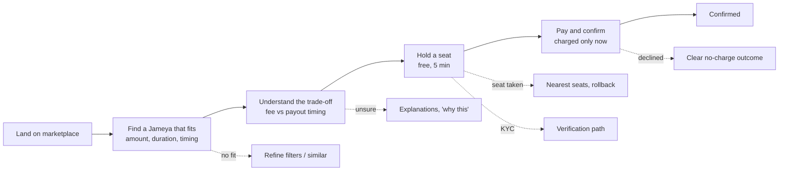

# Marketplace UX Strategy (Task 2, frontend view)

**Goal:** more members who complete a reservation, without pressure that a regulated, trust-based
product cannot justify. The strategy optimizes for **confirmed seats per visit**, and treats
"hold placed, never paid" as a cost, not a win.

## 1. Conversion model

The funnel has five steps, each with a different failure mode:

Each arrow labelled "no fit" or "unsure" is a place the design earns or loses a member. The
strategy is to make the fit and the trade-off obvious before the first commitment (a hold), and to
make every failure recoverable.

## 2. Information hierarchy

The marketplace answers, in order, the questions a member asks:

1. **How much per month, and for how long?** The monthly amount and duration are the first two facts
   on every card, in the same order, with units.
2. **What do I get back, and what does it cost?** Payout and the fee range sit next to each other.
   The fee range is shown as a range, not a single number, because fees depend on the seat.
3. **When does it start?** The start date is a calendar date, not a relative phrase.
4. **Is there room?** Seats left is a count with a bar, not an icon.
5. **Why is it recommended?** Ranking reasons are available under "Why this?", collapsed, so the
   primary card stays calm.

Badges are the last layer, and every badge states a fact (`Only 2 seats left`, `Starts in 24 days`).

## 3. Recommendations and "why this"

- The default sort is `recommended`. The list is labelled "Recommended for you", which says what the
  order is.
- The reasons come from the server (`ranking.reasons`), so the copy is never invented in the UI.
  Examples: "Matches your usual monthly amount", "Only 2 seats left".
- Sort options each carry one sentence on what they optimize (`sort-options.ts`). A member choosing
  "Lowest monthly amount" knows what they are getting.
- Filters are in the URL. A recommendation can be shared, and the back button works.

## 4. Urgency: truthful and bounded

Urgency is useful when it is true, and harmful when it is not. The rules:

| Signal | Allowed | Not allowed |
|---|---|---|
| Seats left | The exact server count (`seatsAvailable`) | Rounded or inflated numbers, "last chance" when it is not |
| Hold countdown | The server's `expiresAt`, shown to the second | A timer that resets, or a fake deadline |
| Start date | The real date, and "starts soon" only from `STARTING_SOON` | Relative phrases that imply a deadline the product does not have |
| Scarcity badge | `ALMOST_FULL` from the server | A badge computed in the UI |
| Hold itself | Free to place, and says so | Language implying payment is required to hold |

A hold is a placement, not a purchase. The copy says so everywhere a hold is offered:
"Holding a seat is free and lasts a few minutes. You are charged only when your seat is confirmed."

## 5. Trust signals

Regulated fintech needs visible reasons to trust:

- **Money is always explicit.** Every amount has the currency, two decimals and a label
  ("Monthly contribution", "Seat fee (locked)", "Charged today"). The fee is stated as locked at hold
  time, because the contract locks it.
- **Money outcomes are stated for every failure.** Each failure copy states whether a charge
  happened. Declines say "Your card was not charged; the authorization was voided."
- **The payment rules are on the page.** The checkout explains that the provider authorizes
  funds first, and captures only after the seat is confirmed.
- **Test provider is named.** The payment step labels the five tokens as a simulated provider.
  Nothing is hidden.
- **Freshness is shown.** "Availability updated 3s ago" tells the member how current the numbers are.

## 6. KYC funnel

Verification is a gate, not a wall. The design keeps the funnel moving:

| KYC state | What the member sees | What they can still do |
|---|---|---|
| `VERIFIED` | Nothing | Everything |
| `PENDING` | "Verification in progress. Reserving unlocks once your identity check is approved." | Browse, compare, read "Why this?" |
| `REJECTED` | "Verification was not approved." with the support path | Browse |
| `UNKNOWN` | "Verification temporarily unavailable. Browsing still works." | Browse; retry reserving later |

The KYC banner only appears when action is needed, and seats that are blocked say why in text.

## 7. Empty and edge states

| State | Design response |
|---|---|
| No Jameyas match | Explains the likely cause and offers the two filters that most often matter (range, duration) |
| Jameya full | Says so, and links to Jameyas with the same monthly amount |
| Restricted seat | Greyed out with the reason in text, not just colour |
| Hold limit reached | Names the limit, and links to My reservations to release one |
| Session ended | Explains, keeps the destination, and returns the member to where they were |
| Payment pending | "Confirming your payment", with the expectation that it can take a few seconds |
| Hold ended | Disables payment and says the member can choose the seat again |

## 8. Accessibility

- **Semantic structure:** one `h1` per page, sections labelled by headings, `nav` landmarks, a skip
  link, and `role="search"` on the filters.
- **Seat map as a radio group:** a single tab stop, arrow-key movement, Space to select. Disabled
  seats are skipped, and their accessible name includes the state and the reason.
- **Live regions:** checkout phase changes are announced politely; the countdown is not announced
  every second (only the time-left note is read on demand). Errors use `role="alert"`.
- **Colour is never the only signal:** every status has a text label, and restrictions have text.
- **Targets:** interactive controls have a minimum height of 44 px (`min-h-11`).
- **Motion:** no auto-rotating carousel. The featured carousel is scrolled by buttons or keyboard.
- **Reduced motion:** the only animation is the pulse on a seat being held, and it stops when the
  hold resolves.
- **Layout:** mobile-first; the seat grid reflows from 3 to 6 columns; no horizontal page scroll
  (the carousel is the only horizontally scrolling region, and it is labelled).

## 9. What we deliberately did not do

- No fake scarcity, countdowns that reset, or "X people are viewing this".
- No pre-selected seat or default payment method that moves money.
- No dark patterns on release: releasing a hold is one click with a clear result.
- No personalization that hides the fee or the payout timing for a segment.
