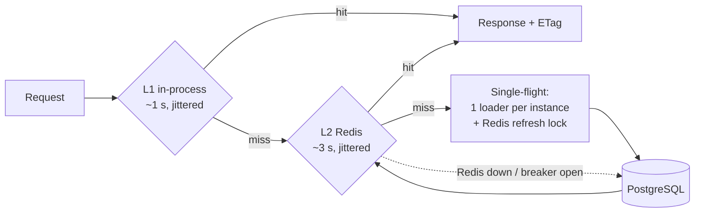

# Backend Performance & Resilience

> Scope: the performance pass on the NestJS backend. Companion: [frontend.md](frontend.md).
> Related decisions: [ADR-0004 outbox](../architecture/adr/0004-transactional-outbox.md),
> [ADR-0008 marketplace snapshot](../architecture/adr/0008-in-memory-marketplace-snapshot.md)
> (now extended to a two-tier cache, see §4).

## 1. Method

1. Benchmark first, then change, then benchmark again with the same harness.
2. Prove "no N+1" with tests, not just review: a query-counting wrapper around the pg pool
   asserts the number of queries per endpoint is **constant** as the data grows.
3. Re-run the 1,000-user contention test after every change to the booking path.

Harness: `autocannon`, 50 connections, 10 s per scenario, run inside the compose network
(`docker compose -f docker-compose.yml -f backend/docker-compose.test.yml run --rm backend-bench`).
Member tokens and client IPs are rotated so per-user/per-IP rate limits don't dominate.

## 2. Results (same laptop, Docker Desktop, 5,000 Jameyas / ~69k seats)

Baseline = commit `67b4d08` (harness only), fresh stack. After = `0319ce0`.

| Scenario | req/s before → after | p50 ms | p99 ms | Change |
|---|---|---|---|---|
| `GET /jameyas` recommended, page 1 | **106 → 1,647** | 460 → 30 | 884 → 67 | **15.5× throughput** |
| `GET /jameyas` recommended, page 5 | **103 → 1,635** | 427 → 28 | 3,833 → 56 | **15.9×**, p99 tail removed |
| `GET /jameyas` filtered + sorted | 1,097 → 1,676 | 44 → 28 | 70 → 58 | +53% |
| `GET /jameyas/:id` (seat map) | 1,406 → 1,994 | 32 → 26 | 96 → 58 | +42% |
| `POST /events` (10 per batch) | 1,388 → 1,658 | 35 → 27 | 75 → 58 | +19%, 0 DB work on request |
| `GET /me` | 1,971 → 2,223 | 27 → 24 | 45 → 44 | +13% |
| `GET /jameyas/featured` | 1,941 → 1,840 | 26 → 26 | 47 → 51 | ≈ flat |
| `GET /reservations` | 2,266 → 2,025 | 23 → 24 | 34 → 44 | −11% |

**Reading the table honestly**
- The big win is the personalised list: it used to aggregate seats and score all 5,000
  Jameyas per request; now aggregates are precomputed and ranked lists are memoised.
- Endpoints that were already cheap are flat or slightly slower: every request now passes
  through the global rate limiter and compression middleware (one Redis round-trip), and the
  "after" run shared the machine with the frontend container. That overhead is the price of
  abuse protection and is acceptable at these latencies.
- Numbers are from one machine with all services on shared CPUs; use them to compare, not
  as capacity planning.

**Contention (1,000 concurrent members, one 20-seat Jameya), after the pass**

| Mode | Outcome | Wall time | p99 | Double bookings |
|---|---|---|---|---|
| spread over 20 seats | 20 × `201`, 786 × `JAMEYA_FULL`, 194 × `SEAT_UNAVAILABLE` | 1.8 s | 1.77 s | **0** |
| everyone on seat 1 | 1 × `201`, 999 × `SEAT_UNAVAILABLE` | 1.3 s | 1.20 s | **0** |

## 3. N+1 findings and fixes

| Where | Before | After | Guard test |
|---|---|---|---|
| Marketplace snapshot | Aggregated ~69k seat rows for fee range/totals per refresh | `total_seats`, `min_fee`, `max_fee` denormalised on `jameyas` (triggers); availability via index-only count (21.4 → 4.7 ms) | list with 5 vs 50 items → same query count |
| Jameya detail | Jameya + seats + viewer lookups in separate round-trips | Seat map in one query (`json_agg`), viewer (profile + KYC + preferences) in one query | 6 vs 24 seats → same query count |
| `GET /reservations` | Payment looked up per reservation | Payments joined set-based | 1 vs 4 reservations → same count |
| `GET /me` | Several lookups | Exactly 2 queries (viewer, active holds) | asserts `2` |
| Hold-expiry sweeper | Released seats row by row | One set-based `UPDATE … FROM` per batch | 2 vs 20 expired holds → same count |
| Outbox relay | Loaded payment per command | Batch claim joined with payment data | — |
| `POST /events` | Insert per request | Write-behind buffer, batch insert | 0 queries on request path, 1 per flush |

Tests: `backend/test/query-count.e2e-spec.ts` (helper: `backend/test/support/query-counter.ts`).

## 4. Database

Migration `backend/migrations/0002_performance.sql`:

| Change | Purpose |
|---|---|
| `jameyas.total_seats / min_fee / max_fee` + statement-level insert trigger + fee-change trigger | List never aggregates seats. Status changes (booking hot path) **never** touch the `jameyas` row, so there's no hot-row lock under contention. |
| `reservations_active_by_user_idx (user_id) INCLUDE (jameya_id, id)` partial on active statuses | Index-only "active holds of this member" for booking checks and `/me` |
| `payment_outbox_payment_command_uq (payment_id, command)` | Each provider command at most once per payment |
| `payment_outbox_single_settlement_uq (payment_id)` partial on capture/void | A payment is settled (captured **or** voided) at most once — DB-level guarantee |
| Pool: `statement_timeout`, `idle_in_transaction_session_timeout`, connect timeout | No runaway query or leaked transaction can hold locks |
| Named prepared statements on hot paths | Skip re-planning for the most frequent queries |

Seat availability is deliberately **not** stored on `jameyas`: that would make every seat claim
lock the same parent row, serialising the 1,000-user scenario.

## 5. Caching

| Data | L1 | L2 (Redis) | Invalidation | Used by booking? |
|---|---|---|---|---|
| Marketplace snapshot (all open Jameyas + base ranking signals) | 1 s | 3 s | TTL (≤5 s staleness allowed) | No |
| Ranked list per (variant, filters, sort) | memoised (LRU) per snapshot | — | new snapshot | No |
| Seat map per Jameya | — | 2 s | **deleted on every committed seat change** | **Never** |
| KYC status | — | fresh ~10 min, stale-if-error 24 h | TTL | Strict path (fail closed) |
| Availability gate counter | — | 120 s, rebuilt every 10 s from DB | `INCRBY` after commit | Advisory only (fast fail) |

Also: weak **ETag + `304 Not Modified`** on marketplace GETs, **gzip/brotli** for bodies > 1 kB.

## 6. Rate limiting

Atomic Redis sliding-window counter (Lua, Redis clock) → headers `RateLimit-Limit`,
`RateLimit-Remaining`, `RateLimit-Reset`, and `Retry-After` on `429`. If Redis is unavailable
(breaker open) a per-instance in-memory limiter takes over (fail **open to local**, not to unlimited).

| Policy | Limit | Key |
|---|---|---|
| Global ceiling | `RATE_LIMIT_IP_PER_10S` per 10 s | client IP (`X-Forwarded-For` trusted from private proxy ranges only) |
| Login | 5 / 60 s | IP |
| Login | 10 / 15 min | email (credential stuffing across IPs) |
| Create reservation | 5 / 10 s | member |
| Checkout | 10 / 60 s | member |
| Cancel | 10 / 10 s | member |
| Poll reservation | 60 / 10 s | member |
| List reservations | 30 / 10 s | member |
| Events | 60 / 10 s | member |
| Payment webhook | 300 / 10 s | source IP |

Single source of truth: `backend/src/shared/http/rate-limit/policies.ts`.

## 7. Circuit breakers

Reusable `CircuitBreaker` + `BreakerRegistry` in `backend/src/shared/resilience/`
(closed → open after N consecutive failures → half-open single probe → closed).
States are exposed as an additive field in `GET /health`.

| Dependency | Threshold / open time | When open |
|---|---|---|
| KYC provider | env `KYC_BREAKER_FAILURE_THRESHOLD` / `KYC_BREAKER_OPEN_MS` | Serve cached status; no cache → `503 KYC_UNAVAILABLE` (booking fails closed, browsing works) |
| Payment gateway (`ResilientPaymentGateway` decorator, with call timeouts) | 5 failures / 10 s | Commands stay in the outbox and are retried; the user sees `PAYMENT_PENDING`, never a false failure |
| Redis (`RedisService.guard`) | 3 failures / 5 s | Caches read from PostgreSQL; gate and seat lock fail open (DB still guarantees one winner); local rate limiter |

## 8. Async work

| Task | Before | After | Guarantee kept |
|---|---|---|---|
| Provider authorization | Called after commit from the request | Outbox command committed **with** checkout, kicked immediately after commit, retried by relay | No lost authorize if the process crashes after commit |
| Capture / void | Outbox | Outbox, batch-claimed with payment data | Settled at most once (unique index) |
| Analytics events | Insert per request | Write-behind buffer, flushed every 250 ms or 500 events, and on shutdown | Best-effort by design (analytics, not money) |
| Ranking base signals | Per request | Precomputed per snapshot refresh | ≤5 s staleness |
| Hold expiry, reconciliation | Jobs | Unchanged, set-based, advisory-lock singletons | — |

## 9. Trade-offs and limitations

- Per-instance L1 cache and breaker state: instances detect failures independently; L1 adds up
  to ~1 s staleness on top of Redis (still inside the 5 s budget).
- ETags include `asOf`, so they change on every snapshot refresh and 304s are rarer than they
  could be (GAP-FE-013). Next step: hash the payload without volatile fields.
- Events in the write-behind buffer are lost if the process is killed hard (not on graceful
  shutdown). Acceptable for analytics; never used for money.
- The global per-IP limiter adds one Redis round-trip to every request (see §2).
