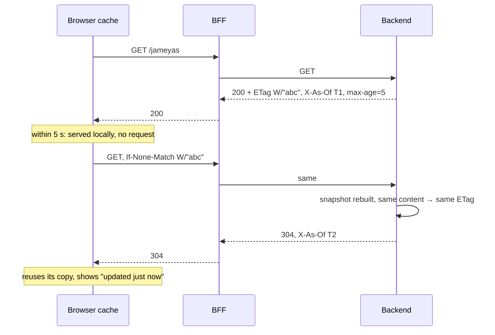

# Caching: ETags, 304 and `X-As-Of`

**In short:** each read carries a fingerprint (ETag) of what the member sees. The client sends it back, and if nothing visible changed, the server answers `304 Not Modified` with no body. Timestamps are left out of the fingerprint and sent in an `X-As-Of` header, so "updated Xs ago" still moves.

Contract: [API caching](../api/README.md#caching-etag) · Decisions: [ADR-0011](../architecture/adr/0011-stable-etags.md), [ADR-0009 two-tier cache](../architecture/adr/0009-two-tier-cache.md)

## Why it was needed

In v1.0 the ETag hashed the whole body, including `asOf`, which changes every few seconds. So the ETag changed even when nothing visible had, and `304` almost never happened.

Polling every 5 s, 12 times:

| Endpoint | Old ETag matched | Stable ETag → `304` |
|---|---|---|
| `GET /jameyas/{id}` | 0 / 12 | **12 / 12** |
| `GET /me` | no ETag | **12 / 12** |
| `GET /jameyas` | 0 / 12 | **7 / 12** (the other 5 were real seat changes) |

Bytes over those 12 requests: detail 24.6 → 1.9 KB, `/me` 3.8 → 0.3 KB, list 122 → 56 KB.

## How the ETag is computed

**Rule: the ETag changes if and only if something the member sees changes.**

| Endpoint | Method | Fingerprint covers | Left out |
|---|---|---|---|
| `/jameyas`, `/featured`, `/similar` | From inputs | Snapshot content hash + A/B variant + viewer preferences + query | `asOf` |
| `/jameyas/{id}` | From body | Seats, restrictions, viewer block, badges | `asOf` |
| `/me` | From body | Profile, KYC, limits | `kycCheckedAt` |
| `/reservations`, `/reservations/{id}` | From body | Everything, including payment | nothing |

- **From inputs:** the snapshot's content hash is computed once per rebuild. If `If-None-Match` matches, the server answers `304` **before** ranking or rendering anything.
- **From body:** the body is serialised once; the stable part is hashed.
- **Why preferences are included:** the same snapshot ranks differently per member, and reasons like "Matches your usual monthly amount" are personal.
- **Why reservations hash the whole body:** a payment change doesn't touch `reservations.updated_at`, so a row-version ETag would miss it.

## Request flow

## What changes an ETag

| Change | List | Detail | `/me` | Reservations |
|---|---|---|---|---|
| Anyone holds, releases or confirms a seat | next snapshot (≤ 4 s) | immediately | – | – |
| My hold count | – | yes | yes | yes |
| Reservation or payment status | – | if my seat view changes | – | yes |
| Campaign starts or ends; a new day | next snapshot | yes | – | – |
| My preferences or A/B variant | yes | yes | yes | – |
| KYC re-checked, same result | – | – | **no** | – |
| Snapshot rebuilt, nothing changed | **no** | – | – | – |

## Safety

- **Booking never reads a cache.** Reserve, checkout and cancel work directly on PostgreSQL. A stale view can at worst show a seat that is already gone, and booking answers `409`.
- **Reservation reads are live.** The ETag only avoids re-sending an unchanged body.
- **Staleness is bounded:** marketplace data is at most 5 s old (in-process 1 s + Redis 3 s), and `X-As-Of` says exactly how old.
- **Weak comparison** follows RFC 9110 (`W/"x"` matches `"x"`).
- **Tested** in `backend/test/conditional-get.e2e-spec.ts`: same ETag across a rebuild with no change; new ETag after a seat is reserved or a reservation is cancelled; `/me` ignores `kycCheckedAt`.

## Server cost

| Scenario | 200 req/s | 304 req/s |
|---|---|---|
| `GET /jameyas` page 1 | 1,477 | 1,890 |
| `GET /jameyas/{id}` | 1,610 | 1,869 |
| `GET /me` | 1,780 | 1,991 |

A `304` is cheaper but not free: authentication, rate limiting and the viewer lookup still run, because they decide which ETag applies. The big savings are on the network and in the browser.

## In the browser

- Reads use the normal HTTP cache. The browser itself sends `If-None-Match`; application code never does, and a `304` reaches the app as a normal `200`.
- "Updated Xs ago" reads `X-As-Of`, so it moves even on a `304`.
- TanStack Query keeps object references for unchanged data and cards are memoised, so only changed cards re-render.
- Server-prefetched data keeps its timestamp, so the client doesn't refetch right after hydration.
- Logout sends `Clear-Site-Data: "cache"`, so the next person on the browser can't see cached responses.
