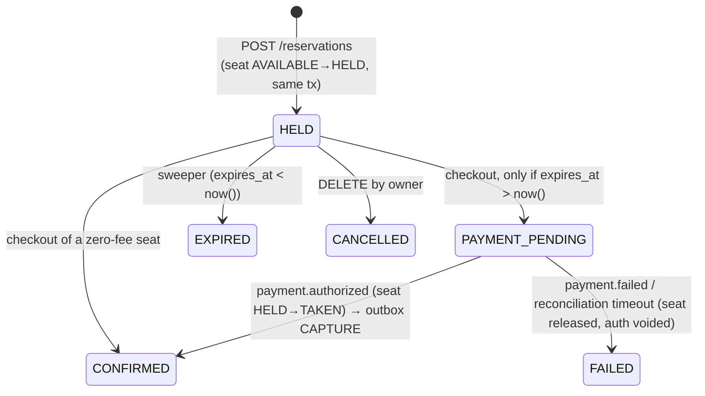
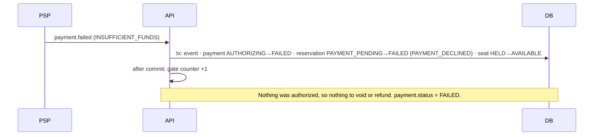
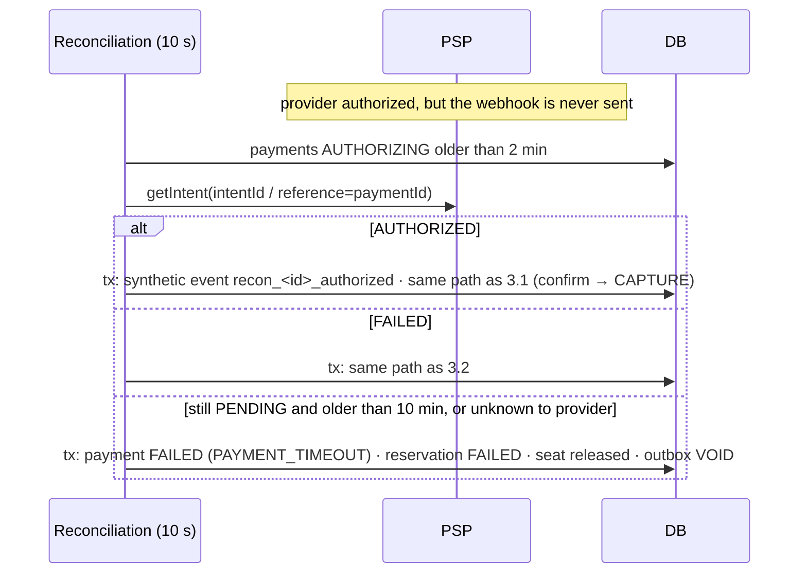

# Seat Reservation (Task 1)

This document explains how a member goes from "I want seat 7" to a confirmed, paid seat, and why
the design cannot sell a seat twice or charge a member without a seat.

Code: `backend/src/modules/reservations`, `backend/src/modules/payments`, `backend/src/modules/catalog`.
Contract: [`docs/api/reservations.md`](../api/reservations.md), [`payments-webhook.md`](../api/payments-webhook.md).

## 1. Lifecycle



The same table is enforced three times: in code (`reservation-state-machine.ts`), in every
`UPDATE` (`WHERE status = ANY(<legal sources>)`), and by the `reservations_status_guard` trigger.

Payment states: `AUTHORIZING → AUTHORIZED → CAPTURED | VOIDED`, `AUTHORIZING → FAILED`, and
`FAILED → VOIDED` (a late authorization after a timeout is voided).

## 2. Placing a hold

Checks run in the contract order, cheapest first:

| # | Check | Where | Result |
|---|---|---|---|
| 1 | Rate limit 5 / 10 s / member (Redis sliding window, local fallback) | `RateLimitGuard` | `429` + `Retry-After` |
| 2 | Idempotency key (claim / replay / in-progress / reused) | `IdempotencyInterceptor` | replay, `409`, `422`, `400` |
| 3 | KYC verified (cache → breaker → stale-if-error) | `KycVerifiedHandler` | `403 KYC_REQUIRED`, `503 KYC_UNAVAILABLE` |
| 4 | One active hold per Jameya; ≤ `maxActiveHolds` (3, or 1 after ≥ 3 expired holds) | `SingleActiveReservationHandler`, `HoldLimitHandler` | `409` |
| 5 | Risk tier (HIGH cannot take the earliest 30% of seats) | `RiskTierHandler` | `403 RISK_RESTRICTED` |
| 6 | Redis gate: available counter > 0; per-seat single-flight lock | `AvailabilityGateService` | `409 JAMEYA_FULL` / `SEAT_UNAVAILABLE` |
| 7 | Atomic claim in PostgreSQL | `CreateReservationUseCase.claimInTransaction` | `201` or `409 SEAT_UNAVAILABLE` |

Step 7 is one transaction:

```sql
SELECT pg_advisory_xact_lock(hashtext('reservations:user:' || $user));   -- serialise this member
SELECT count(*) … WHERE user_id = $user AND status IN ('HELD','PAYMENT_PENDING');  -- re-check 4
UPDATE seats SET status='HELD', reservation_id=$res, holder_user_id=$user
 WHERE jameya_id=$j AND seat_number=$n AND status='AVAILABLE' RETURNING fee;     -- the claim
INSERT INTO reservations (…, fee, status, expires_at) VALUES (…, $fee, 'HELD', now() + 300s);
INSERT INTO audit_log …;
```

The fee is **locked at hold time** (copied into the reservation). Later price changes do not
affect it.

## 3. Sequence diagrams

### 3.1 Happy path (`tok_success`)

```mermaid
sequenceDiagram
  autonumber
  participant M as Member
  participant API
  participant DB as PostgreSQL
  participant PSP as Provider (simulator)
  participant OB as Outbox relay
  M->>API: POST /reservations {seat 7}
  API->>DB: tx: claim seat (AVAILABLE→HELD) + insert HELD reservation
  API-->>M: 201 HELD (expiresAt)
  M->>API: POST /reservations/{id}/checkout {tok_success}
  API->>DB: tx: HELD→PAYMENT_PENDING if expires_at>now(); insert payment AUTHORIZING
  API->>PSP: authorize(reference=paymentId, amount=fee)
  PSP-->>API: intentId
  API-->>M: 202 PAYMENT_PENDING (payment AUTHORIZING)
  loop poll every ~1.5 s
    M->>API: GET /reservations/{id}
  end
  PSP->>API: webhook payment.authorized (HMAC)
  API->>DB: tx: insert event (dedup) · lock payment · PAYMENT_PENDING→CONFIRMED · seat HELD→TAKEN · payment AUTHORIZED · ledger AUTHORIZE · outbox CAPTURE
  OB->>DB: claim outbox row (SKIP LOCKED, lease)
  OB->>PSP: capture(intent, key=capture:paymentId)
  OB->>DB: tx: payment CAPTURED · ledger CAPTURE · outbox DONE
  M->>API: GET /reservations/{id}
  API-->>M: CONFIRMED, payment CAPTURED
```

### 3.2 Declined (`tok_decline`)



### 3.3 Duplicate callback (`tok_duplicate`)

```mermaid
sequenceDiagram
  participant PSP
  participant API
  participant DB
  par three concurrent deliveries of evt_X
    PSP->>API: payment.authorized evt_X
    PSP->>API: payment.authorized evt_X
    PSP->>API: payment.authorized evt_X
  end
  API->>DB: INSERT payment_events(evt_X) ON CONFLICT DO NOTHING
  Note over DB: one insert wins; the other two wait on the PK, then insert nothing
  API-->>PSP: {duplicate:false} once, {duplicate:true} twice
  Note over API,DB: Only the winner confirms the seat and enqueues CAPTURE.<br/>Outbox UNIQUE(payment_id) and ledger UNIQUE(payment_id, CAPTURE) make a second capture impossible.
```

### 3.4 Lost callback / provider timeout (`tok_timeout`)



Our documented choice for `tok_timeout`: the simulator **authorizes** but never calls back, so
reconciliation confirms the seat about 2 minutes later (`PAYMENT_PENDING → CONFIRMED`). The
10-minute timeout branch is exercised by `tok_slow` in the integration tests.

### 3.5 Hold expiry racing payment

```mermaid
sequenceDiagram
  participant M as Member
  participant API
  participant SW as Sweeper
  participant DB
  par at T = expires_at - ε
    M->>API: checkout
    API->>DB: SELECT … FOR UPDATE (row lock) → UPDATE … WHERE status='HELD' AND expires_at > now()
  and
    SW->>DB: SELECT … WHERE status='HELD' AND expires_at < now() FOR UPDATE SKIP LOCKED
  end
  Note over DB: The sweeper skips the locked row. If checkout won before expiry → PAYMENT_PENDING, and the sweeper can never expire it.<br/>If the clock passed expiry → checkout matches 0 rows → 410 RESERVATION_EXPIRED; the next sweep expires the hold.
```

### 3.6 Authorization arrives after we gave up

```mermaid
sequenceDiagram
  participant REC as Reconciliation
  participant PSP
  participant API
  participant DB
  REC->>DB: 10 min without auth → payment FAILED (PAYMENT_TIMEOUT), reservation FAILED, seat released, outbox VOID
  PSP->>API: payment.authorized (very late)
  API->>DB: tx: payment is FAILED → ledger AUTHORIZE + outbox VOID (re-armed)
  API->>PSP: (relay) void(intent)
  API->>DB: payment FAILED→VOIDED · ledger VOID
  Note over API,DB: The member is never charged; the reservation stays FAILED.
```

## 4. How consistency is ensured

1. **Single writer per seat.** The seat row's conditional update serialises claimants. The
   partial unique index on live reservations is the second line of defence.
2. **Atomic coupling.** Seat state, reservation state, payment state, ledger, outbox, and audit for
   one decision commit together or not at all.
3. **Every transition is conditional** on the expected source state. Replays, duplicates, and
   out-of-order events match zero rows and are recorded as `IGNORED`.
4. **No side effects inside transactions.** Provider calls happen after commit (authorize) or via
   the outbox (capture/void), so a crash can lose only work that the outbox or reconciliation will redo.
5. **Recovery is automatic.** Reconciliation resolves stuck payments and orphan events. The gate
   rebuild corrects Redis. Idempotency leases expire after 60 s if their owner crashed.
6. **The database refuses illegal states** (triggers, CHECKs, unique indexes) even if application code regresses.

## 5. Trade-offs

| Choice | Benefit | Cost |
|---|---|---|
| Hold first, pay second (5 min) | The member knows the seat is theirs before entering payment details | Seats can be hoarded; mitigated by hold limits, behavioural penalties, and rate limits |
| Authorize/capture | No refunds; an exact guarantee | Two provider calls; authorizations can expire if capture were delayed for days (not the case here: about 1 s) |
| `PAYMENT_PENDING` never expires by TTL | No seat released while money is in flight | A seat can be blocked up to 10 min by a stuck payment |
| Redis gate fails open | Redis outage ≠ booking outage | During an outage all contention reaches PostgreSQL (still correct, only slower) |
| Per-seat single-flight lock | Collapses N concurrent claims on one row into 1 DB statement | A request can lose to a competitor that later fails; the member retries |
