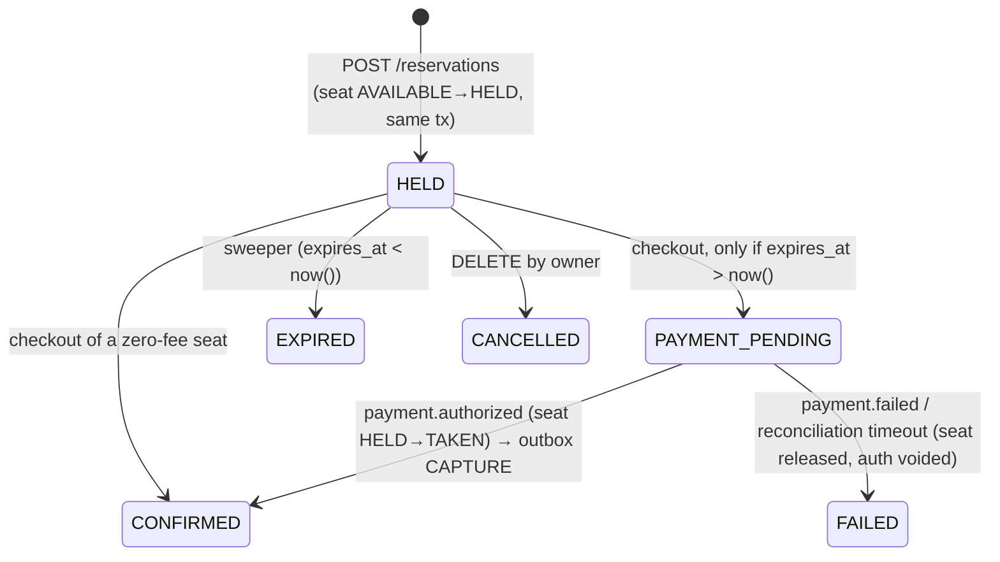
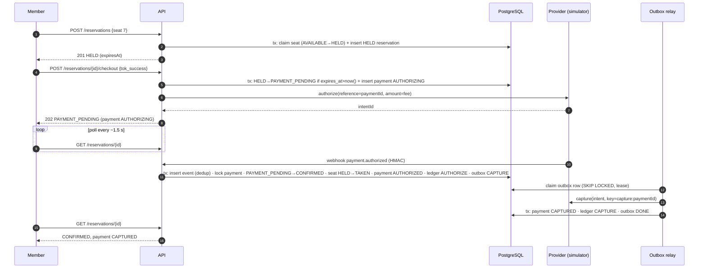
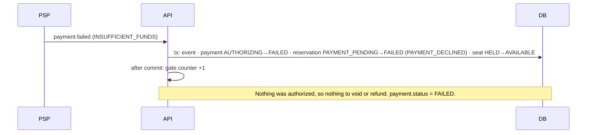
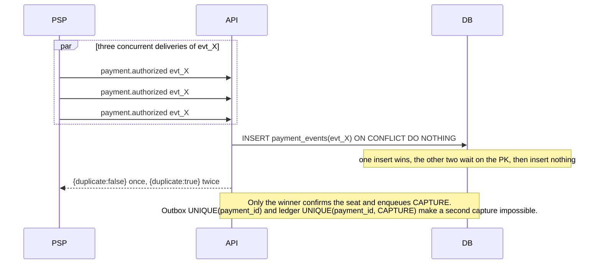
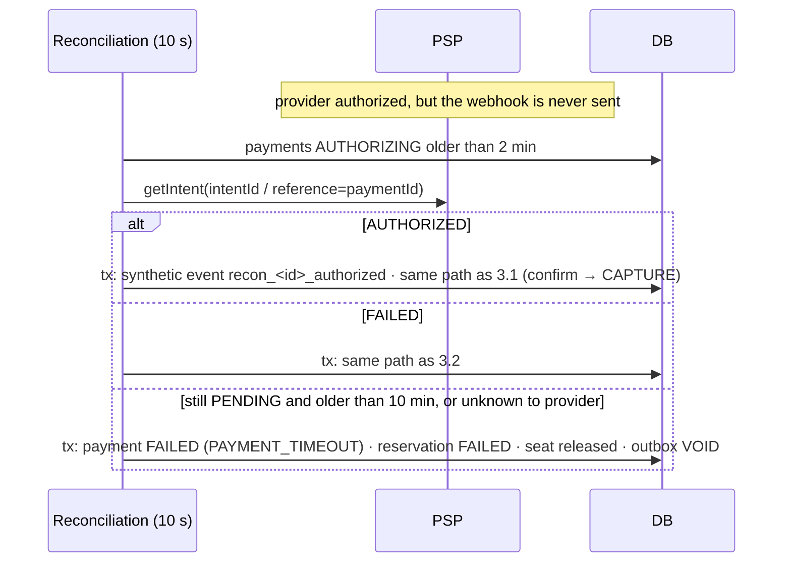
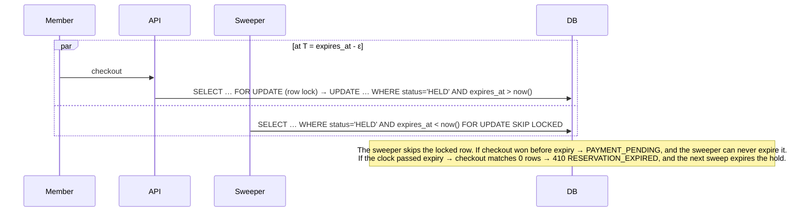

# Seat Reservation (Task 1)

How a member goes from "I want seat 7" to a paid, confirmed seat.

**In short:**

- PostgreSQL claims the seat with one conditional `UPDATE`, so only one request can win it.
- The hold lasts 5 minutes. Payment is only **authorized** (funds held) until the seat is confirmed, then **captured**. If the seat is lost, the authorization is **voided**, so there is never a refund.
- Duplicate clicks, duplicate webhooks and lost webhooks are absorbed by idempotency keys, unique event ids and a reconciliation job.

API: [reservations](../api/reservations.md) · [webhook](../api/payments-webhook.md). Every edge case: [edge cases](edge-cases.md).

## 1. Lifecycle



These transitions are enforced three times: in code, in every `UPDATE ... WHERE status = <expected>`, and by a database trigger.

## 2. Placing a hold

Checks run cheapest first:

| # | Check | Where | Result |
|---|---|---|---|
| 1 | Rate limit: 5 per 10 s per member | `RateLimitGuard` | `429` + `Retry-After` |
| 2 | Idempotency key | `IdempotencyInterceptor` | replay, `409`, `422`, `400` |
| 3 | KYC verified (cached) | `KycVerifiedHandler` | `403 KYC_REQUIRED`, `503 KYC_UNAVAILABLE` |
| 4 | One hold per Jameya, at most 3 in total (1 after 3+ expired holds) | `SingleActiveReservationHandler`, `HoldLimitHandler` | `409` |
| 5 | Risk tier: HIGH can't take the first 30% of seats | `RiskTierHandler` | `403 RISK_RESTRICTED` |
| 6 | Redis gate: seats left? seat already being claimed? | `AvailabilityGateService` | `409 JAMEYA_FULL` / `SEAT_UNAVAILABLE` |
| 7 | Atomic claim in PostgreSQL | `CreateReservationUseCase.claimInTransaction` | `201` or `409 SEAT_UNAVAILABLE` |

Step 7 is one transaction:

```sql
SELECT pg_advisory_xact_lock(hashtext('reservations:user:' || $user));   -- serialise this member
SELECT count(*) … WHERE user_id = $user AND status IN ('HELD','PAYMENT_PENDING');  -- re-check 4
UPDATE seats SET status='HELD', reservation_id=$res, holder_user_id=$user
 WHERE jameya_id=$j AND seat_number=$n AND status='AVAILABLE' RETURNING fee;     -- the claim
INSERT INTO reservations (…, fee, status, expires_at) VALUES (…, $fee, 'HELD', now() + 300s);
INSERT INTO audit_log …;
```

The fee is copied into the reservation, so later price changes don't affect it.

## 3. Sequence diagrams

### 3.1 Happy path (`tok_success`)



### 3.2 Declined (`tok_decline`)



### 3.3 Duplicate callback (`tok_duplicate`)



### 3.4 Lost callback / provider timeout (`tok_timeout`)



With `tok_timeout` the simulator authorizes but never calls back, so reconciliation confirms the seat about 2 minutes later.

If an authorization arrives **after** a payment was timed out, it is voided straight away and the reservation stays `FAILED`. The member is never charged.

### 3.5 Hold expiry racing payment



## 4. How consistency is ensured

1. **One winner per seat.** A conditional update claims the seat; a unique index backs it up.
2. **All or nothing.** Seat, reservation, payment, ledger, outbox and audit change in one transaction.
3. **Conditional transitions.** Duplicates and out-of-order events match zero rows and are ignored.
4. **No provider calls inside transactions.** Capture and void go through an outbox, so a crash loses nothing.
5. **Self-healing.** Reconciliation settles stuck payments; the Redis gate is rebuilt from PostgreSQL.
6. **The database refuses illegal states** (triggers, checks, unique indexes), even if the code has a bug.

## 5. Trade-offs

| Choice | Benefit | Cost |
|---|---|---|
| Hold first, pay second | The seat is theirs before they enter card details | Hoarding, limited by hold limits and rate limits |
| Authorize, then capture | No refunds ever | Two provider calls |
| `PAYMENT_PENDING` never times out by TTL | No seat released while money is moving | A stuck payment can block a seat up to 10 min |
| Redis gate fails open | Redis down doesn't stop booking | All load reaches PostgreSQL (correct, slower) |
| Per-seat single-flight lock | N claims on one seat become 1 DB query | A loser may need to retry if the winner fails |
